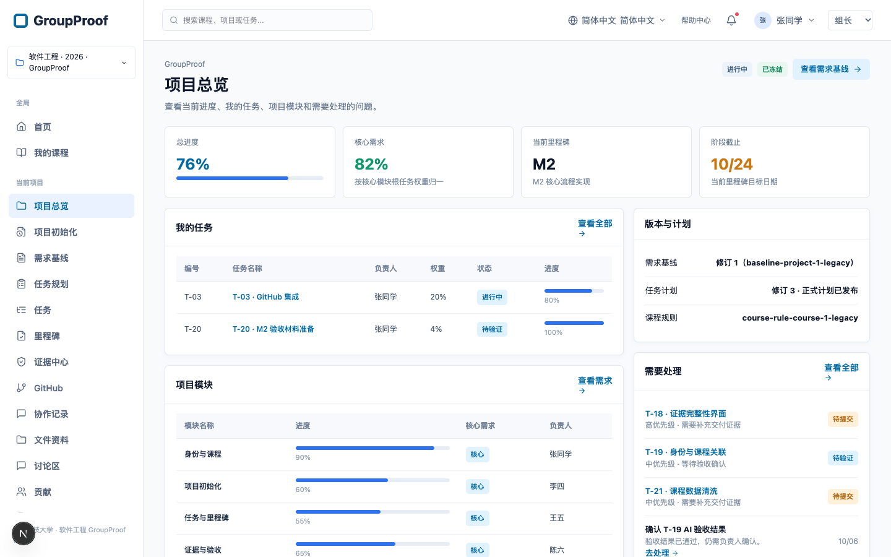

# GroupProof

GroupProof 是为课程小组作业设计的协作与评估平台。小组交出一份共同成果，老师还需要知道每位同学负责什么、哪些要求已经达到、个人贡献怎么算出来。GroupProof 把分工和验收标准写进任务，让成员在交付时附上对应的代码、测试或文档。老师查看贡献比例时，可以一路点回任务、验收记录和当时引用的证据版本。

## 一项任务怎样变成可核对的贡献

假设两位同学一起做课程项目里的「预约取消」功能。一位负责实现，另一位负责编写测试。小组事先约定两条验收标准：「取消后名额会恢复」和「重复取消不会多释放一个名额」。

1. **约定交付。** 小组把需求拆成任务，写下负责人、任务权重和验收标准。成员确认各自的分工，由组长发布这版计划。
2. **提交证据。** 实现者把 GitHub 合并请求关联到任务，测试者把覆盖两种情形的测试记录关联到相应标准。设计说明、文件版本和飞书讨论也可以作为候选材料。采纳时记录来源和版本，以后仍能查回当时用的是哪一份。
3. **逐项验收。** 把进度填到 100% 后，成员仍需提交验收。系统能核对 PR 是否合并、CI 是否通过。负责人再对照两条标准查看测试内容，决定确认还是退回补证。AI 可以提供分析建议，正式成果需要所有任务负责人确认，并记录合计为 100% 的实际承担比例。
4. **核对贡献。** 假设这项任务权重为 10，两人的实际承担比例确认为 60% 和 40%，这项成果就分别贡献 6 和 4 个权重点。系统按各自累计点数占全组总点数的比例计算项目贡献。老师点开成员详情，可以看到哪些任务计入了这项结果，以及每项任务凭什么通过。



## 谁在什么时候使用

| 使用者 | 在项目里做什么 |
| --- | --- |
| 学生与组长 | 开工前确认需求和分工，执行中记录进展、提交材料，验收时确认结果。组长推进计划发布，成员可以从自己的贡献详情查看每项成果。 |
| 教师与助教 | 教师从课程总览了解各组进展、逾期风险和待处理事项。需要复核时，可以查看具体小组的任务、贡献明细和证据。助教按所属课程的授权协助。 |
| 管理员 | 审核教师身份、处理账号与访问申请，并查看操作日志和 AI 用量。 |

结课时，小组可以把里程碑、任务完成情况、有效证据、已冻结的贡献结果和风险汇总成一版报告，导出为 PDF 或 Word。证据被撤回或来源发生变化时，历史记录仍可查看，相关验收和贡献可以重新核对。

## 当前版本

`main` 同时包含演示工作区和接入 FastAPI 的业务页面。本地看到的数据取决于所在页面和开发配置。

- **已接入后端的流程**包括账号注册与登录、学校邮箱验证、教师身份审核，以及任务验收和贡献明细。任务执行、证据中心、风险和报告等页面也有真实 API 入口。后端使用 PostgreSQL 保存数据。
- **课程与计划**在主分支保留演示工作区，供查看建组、需求确认和任务规划的交互。B 成员的课程和计划后端在 `B_task` 分支继续开发。
- **外部服务**按需配置。GitHub App 读取仓库活动，飞书应用读取已绑定群的消息，Supabase Storage 保存上传文件，OpenRouter 提供 AI 分析。本地 Compose 默认使用固定的 AI 示例响应。

## 本地运行

在仓库根目录执行以下命令。需要 Node.js 20–24、npm 和已启动的 Docker（含 Compose v2）。

```bash
npm ci
npm run dev
```

开发脚本会启动 PostgreSQL、Redis 和 FastAPI，执行数据库迁移，再启动 Next.js。打开[本地登录页](http://localhost:3000/login)进入应用。若页面能打开但登录服务不可用，可先查看 [API 就绪状态](http://localhost:8000/readyz) 和 `docker compose logs api`。本地开发默认将验证邮件保存到数据库的 `email_outbox` 表。

## 开发入口

| 想了解什么 | 从哪里开始 |
| --- | --- |
| 页面、角色与导航 | [页面与路由地图](FRONTEND_IMPLEMENTATION_PLAN.md) · [业务页面入口](features/route-dispatcher.tsx) |
| GitHub、飞书、存储和 AI 接口 | [公共服务与接入说明](docs/A_SHARED_SERVICES.md) |
| 候选证据怎样采纳、撤回和保留历史 | [证据规则](docs/C_EVIDENCE.md) · [任务执行规则](docs/C_TASK_EXECUTION.md) |
| 验收、贡献和报告怎样计算 | [验收确认](services/api/app/modules/d/acceptance.py) · [贡献计算](services/api/app/modules/d/contribution.py) · [报告生成](services/api/app/modules/d/reporting.py) |
| 前后端怎样联调、测试和部署 | [环境与工程检查](docs/DEVELOPMENT.md) · [API 契约](packages/domain/openapi.json) · [部署说明](docs/DEPLOYMENT.md) |

团队使用 `A_task`、`B_task`、`C_task`、`D_task` 作为成员开发分支，`develop` 用于集成，`main` 保存发布版本。
