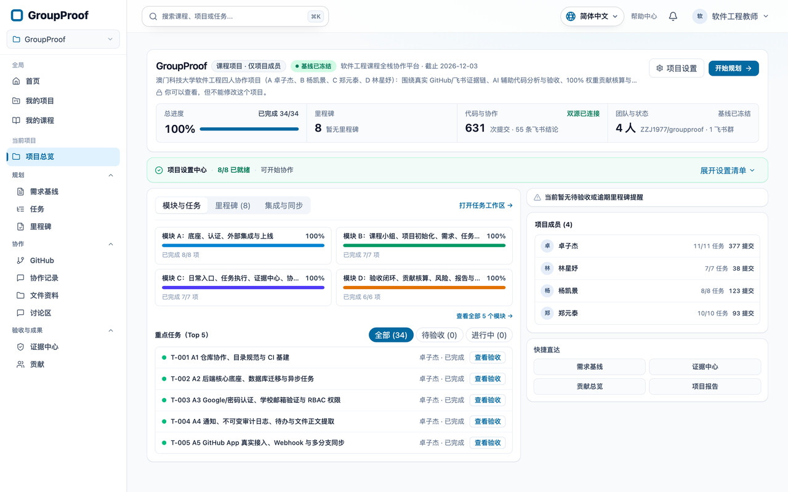
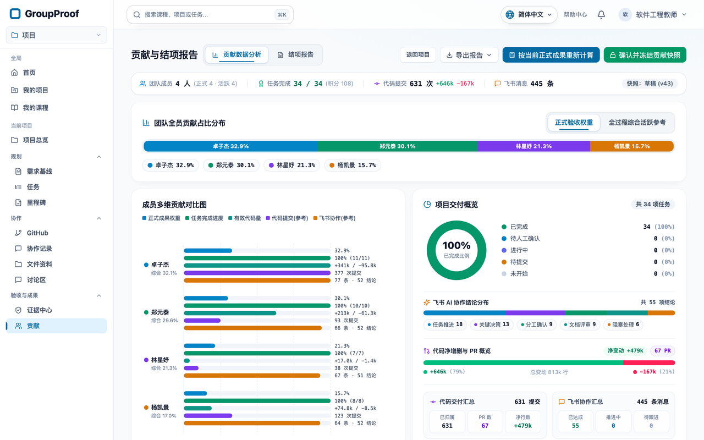
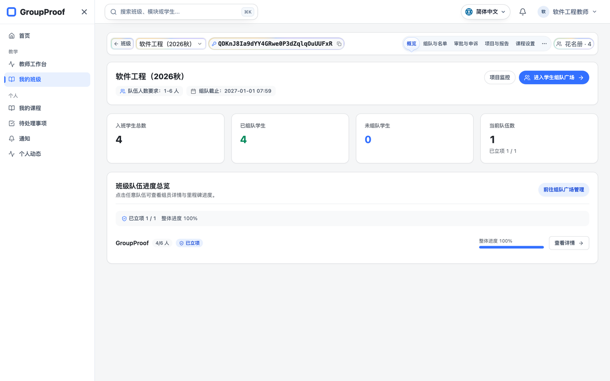
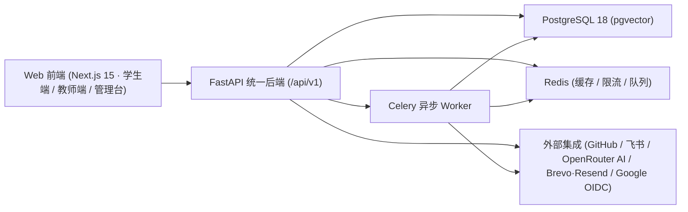

# GroupProof

GroupProof 是面向高校课程项目协作与过程化考核的全栈教学管理平台，围绕 **可核验证据链、人工确认闭环的 AI 辅助验收、师生工作台实时互通** 构建。

## 核心定位与业务闭环

平台覆盖三类角色端，打通「需求基线冻结 → 任务树/看板/列表协同 → GitHub/飞书证据归集 → AI 验收与人工确认 → 贡献核算与 7 章节结项报告」完整闭环：

- **学生工作台 (`student/`)**：独立项目与课程项目双轨协作，支持独立项目一键「移入课程」并同步队友与小组；提供需求基线冻结、任务统一视图、GitHub / 飞书协作同步、证据中心、AI 验收（人工确认必经）与贡献结项报告导出。
- **教师 5-Hub 工作台 (`teacher/`)**：采用独立作用域主题与可折叠侧边栏，整合 **概览 / 组队与名单 / 审批与申诉 / 项目与报告 / 课程设置** 5 大中心（兼容历史 URL），内置 `Cmd/Ctrl+K` 快速跳转、花名册抽屉与跨班仪表盘。
- **管理员治理控制台 (`admin/`)**：用户与身份目录、教师入驻审核、课程治理、不可变操作审计日志、OpenRouter AI 用量统计与环境切换。

## 界面预览

<table>
  <tr>
    <td width="50%" align="center">
      
      <br /><sub><b>品牌登录页</b>：粒子词标、账号密码与 Google OIDC 登录及高校邮箱校验</sub>
    </td>
    <td width="50%" align="center">
      
      <br /><sub><b>项目总览工作台</b>：基线状态、模块进度、GitHub/飞书双源同步与重点任务</sub>
    </td>
  </tr>
  <tr>
    <td width="50%" align="center">
      
      <br /><sub><b>贡献数据分析 v2</b>：全员验收权重占比、有效代码量对比与项目交付概览</sub>
    </td>
    <td width="50%" align="center">
      
      <br /><sub><b>教师 5-Hub 工作台</b>：班级进度 KPI、队伍立项总览、花名册抽屉与快速检索</sub>
    </td>
  </tr>
</table>

## 系统架构概览



## 当前版本状态

- **Staging 与 Production 已上线**：Web / API / Worker 全链路已部署运行，**管理员治理控制台 (`admin/`)** 独立部署并在线可用。
- **全量能力落地**：核心认证（含 Google OIDC 与高校邮箱验证）、双轨项目协作、GitHub / 飞书实时同步、AI 验收与贡献核算 v2 均已接入真实后端（Alembic 迁移头 `0047`）。

## 技术栈与快速入口

- **前端**：Next.js 15 App Router · React 19 · TypeScript · Tailwind CSS v4 · Radix UI · TanStack Query · next-intl（简/繁/英）
- **后端与存储**：FastAPI · SQLAlchemy 2 · Alembic (`0047`) · PostgreSQL 18 (`pgvector`) · Redis · Celery · GitHub App / 飞书 / OpenRouter AI

```text
app/              Next.js App Router 路由、全局样式与 /api/v1 同源代理
student/          学生工作台（课程、项目、执行、评审与 API 客户端）
teacher/          教师 5-Hub 工作台（页面、组件、图表、权限 Hook 与 API 客户端）
admin/            管理员治理控制台（仪表盘、身份/治理页面与客户端）
shared/           跨角色共享壳层、UI 控件、认证、首页/收件箱、i18n 与兼容层
services/         统一 FastAPI 后端 (services/api) 与 Celery 异步 Worker (services/worker)
packages/domain/  后端导出的 OpenAPI 快照 (openapi.json) 与生成的 TS 类型
e2e/ · scripts/   Playwright 端到端测试、工程契约校验与 Railway 部署脚本
```

本地启动（需 Node.js 20–24、Python 3.12 与 Docker）：

```bash
npm ci
cp .env.example .env       # 按需填写本地凭据；严禁使用 source .env
npm run dev                # 自动拉起后端容器 + alembic 迁移，启动 Web (3000) 与 API (8000)
```

详细配置、管理员初始化与全量测试/部署命令见 [本地开发、测试与部署指引](docs/guide/LOCAL_AND_DEPLOY.md)，架构与 OpenAPI 同步流程见 [开发与架构设计](docs/guide/ARCHITECTURE.md)。

## 分支分工与协作流程

| 分支 | 负责人 / 定位 | 说明 |
| --- | --- | --- |
| `A_task` | **卓子杰（组长）** | 基础底座、认证、GitHub/飞书/AI 集成与架构整合 |
| `B_task` | **郑元泰** | 课程、小组、需求基线、任务规划与教师端工作台 |
| `C_task` | **杨凯景** | 任务执行、证据中心、活动记录、讨论区与文件管理 |
| `D_task` | **林星妤** | 自动验收、贡献核算、风险巡检与项目报告 |
| `admin-backend` | 独立部署分支 | 管理后台独立部署 |
| `develop` | 测试集成主干 | 集成开发分支变更，自动部署 Staging |
| `main` | 生产发布主干 | 稳定发布分支，自动部署 Production |

**合入规范**：成员在各自开发分支完成变更后向 `develop` 提交 Pull Request，经自动化 CI 与组长（卓子杰）审查批准后合并部署 Staging，验证无误后同步至 `main` 发布 Production。

## 文档导航

| 文档 | 内容说明 |
| --- | --- |
| [开发与架构设计](docs/guide/ARCHITECTURE.md) | 技术栈、完整目录结构、核心领域与状态机不变量、OpenAPI 契约同步 |
| [本地开发、测试与部署指引](docs/guide/LOCAL_AND_DEPLOY.md) | 本地启动、环境变量、第三方集成、前后端与 Playwright 校验命令、Railway 部署 |
| [前端实现状态](FRONTEND_STATUS.md) | 各模块真实接口接入状态、限制与阶段交付记录 |
| [项目协作规范](AGENTS.md) | 研发协作流程、目录职责与 AI 编码助手约束 |
| [前端页面地图](docs/architecture/FRONTEND_IMPLEMENTATION_PLAN.md) | 全站路由与 56 个设计页 + 教师/管理端扩展页映射 |
| [系统技术方案](docs/architecture/TECHNICAL_PLAN.md) | 系统架构设计与后端模块边界说明 |
| [部署架构文档](docs/architecture/DEPLOYMENT.md) | Staging / Production 环境与基础设施部署参考 |
| [并发压力测试与 AI 成本测算报告](docs/testing/STRESS_TEST_REPORT.md) | 本地 PG16 读写/锁竞争、Staging 公网并发与 OpenRouter 全流程 AI 成本实测 |
