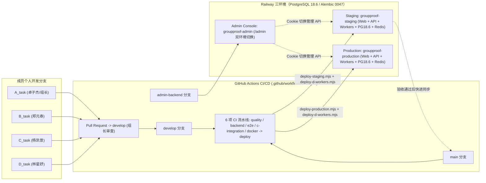

# 部署基线与三环境运维架构

> 更新日期：2026-11-27 · 代码基线：`origin/develop == origin/main`（Alembic 迁移头 `0047`）  
> 返回 [项目首页](../../README.md) · 另见 [开发与架构设计](../guide/ARCHITECTURE.md) · [并发压力测试报告](../testing/STRESS_TEST_REPORT.md)

## 1. 当前线上三环境总览（均已上线，HTTP 200）

GroupProof 在 Railway 上维护三套相互隔离的生产级服务环境，数据库均为 Railway 托管 **PostgreSQL 18.6**（启用 `pgvector` 与 `pgcrypto`），后端统一运行 `services/api`（FastAPI + SQLAlchemy 2 + Alembic `0047`），早期历史原型 `server/` 已彻底下线移除，所有线上环境均强制 `APP_MODE=real` 与 `NEXT_PUBLIC_ENABLE_MOCKS=false`：

| 环境定位 | 跟踪分支 | Railway 项目 | 线上入口 | 核心服务组成 | 说明 |
| --- | --- | --- | --- | --- | --- |
| **Staging（测试与验收）** | `develop` | `groupproof-staging` | <https://groupproof-staging-production.up.railway.app> | `web`、`groupproof` (API)、`report-worker`、`risk-scheduler`、`Postgres 18.6`、`Redis` | 接收个人分支 PR 合并，6/6 CI 通过后自动发布 |
| **Production（正式生产）** | `main` | `groupproof-production` | <https://groupproof-production-production.up.railway.app> | `web`、`groupproof` (API)、`report-worker`、`risk-scheduler`、`Postgres 18.6`、`Redis` | Staging 验收后同步 `main`，6/6 CI 通过后自动发布；数据库结构与 Staging 同步为 `0047` |
| **Admin Console（双环境管理台）** | `admin-backend` | `groupproof-admin` | <https://web-production-650d4574.up.railway.app/admin> | 统一管理 Web 入口 + 指向 Staging/Production 的管理 API 代理 | 顶部环境选择器写入 `gp_admin_environment` Cookie，分别直连 Staging 与 Production 的隔离数据，绝不混库 |

## 2. 三环境 CI/CD 与部署拓扑



## 3. 各环境内部服务拓扑与职责

每个业务环境（`groupproof-staging`、`groupproof-production`）包含独立隔离的服务集合，彼此不共享数据库、Redis、对象存储桶或密钥：

| 服务名 | 根目录 / 启动方式 | 健康检查 / 暴露方式 | 职责说明 |
| --- | --- | --- | --- |
| `web` | 仓库根目录 `Dockerfile`（Next.js standalone） | `GET /healthz`，公网 HTTPS | 学生端、教师 5-Hub 端页面与 `/api/v1/*` 同源运行时代理（经私网 `API_INTERNAL_URL` 转发至 API） |
| `groupproof`（API） | `services/api/Dockerfile` + `entrypoint.sh` | `GET /readyz`（校验 PG 连通性与 Alembic `0047` head），私网优先 | 统一 FastAPI 认证（Argon2id / Session / CSRF / Google OIDC / 邮件 OTP）与 A/B/C/D 全模块业务 API |
| `report-worker` | `services/api` (`railway-report-worker.toml`) | Celery Worker (`app.modules.d.report_tasks:celery_app`)，无公网端口 | 消费 Redis 队列，执行 7 章节结项报告生成、图表渲染与 DOCX/PDF 导出 |
| `risk-scheduler` | `services/api` (`railway-risk-scheduler.toml`) | `python -m scripts.daily_risks --loop`，无公网端口 | 每日定时风险巡检与预警更新 |
| `worker` | `services/worker/` | 后台任务消费者，无公网端口 | 独立异步任务消费者框架 |
| `Postgres` | Railway 托管 PostgreSQL **18.6** | 仅私网可见 | 业务与认证数据主库，启用 `pgvector` 与 `pgcrypto`，时区 `Asia/Shanghai` |
| `Redis` | Railway 托管 Redis | 仅私网可见 | Celery Broker 与异步任务状态支撑 |

> 说明：Web、API、管理后台与 Worker 均作为独立容器部署，支持独立扩缩容与故障隔离。镜像在 `services/api/Dockerfile` 中已内置中文字体与 Cairo 运行时，用于服务端渲染真实 PDF / DOCX / SVG 报告图表。

## 4. 关键环境变量与外部服务配置

`NEXT_PUBLIC_*` 变量会打包进浏览器客户端，仅用于公开开关与非敏感地址；所有数据库串、密钥、OAuth Secret、邮件 API Key、AI Key 与 Railway Token 严禁进入代码仓库，仅配置在 Railway Service Variables 或 GitHub Actions Secrets。

### 4.1 Web 服务核心变量

```text
NEXT_PUBLIC_APP_ENV=staging          # Production 为 production
NEXT_PUBLIC_APP_MODE=real
NEXT_PUBLIC_ENABLE_MOCKS=false       # Staging 与 Production 强制关闭
API_INTERNAL_URL=http://groupproof.railway.internal:8000
```

### 4.2 API 与 Worker 核心变量

```text
APP_ENV=staging                      # Production 为 production
APP_MODE=real
APP_ORIGIN=https://<当前环境公网域名>
DATABASE_URL=${{Postgres.DATABASE_URL}}
DATABASE_TIMEZONE=Asia/Shanghai
REDIS_URL=${{Redis.REDIS_URL}}
RUN_MIGRATIONS_ON_STARTUP=1          # API 启动时幂等执行 alembic upgrade head；Worker 设为 0
EMAIL_CHALLENGE_HMAC_KEY=<32字节随机十六进制密钥，保持稳定>
```

### 4.3 邮件发信通道（Brevo / Resend / SMTP）

学校邮箱验证码、注册验证与密码恢复由 API 服务同步调用发信通道，不经 Celery 队列：

- **Brevo（HTTPS API，推荐无自有域名时使用）**：在 Brevo 验证发件人邮箱并生成 API Key，配置 `MAIL_MODE=brevo`、`BREVO_API_KEY`、`MAIL_FROM`、`MAIL_PUBLIC_ENABLED=true`。
- **Resend（HTTPS API，适合已验证自有域名）**：在 Resend 完成域名的 SPF/DKIM 验证后，配置 `MAIL_MODE=resend`、`RESEND_API_KEY`、`MAIL_FROM`、`MAIL_PUBLIC_ENABLED=true`。
- **SMTP**：配置 `MAIL_MODE=smtp` 及 `SMTP_HOST`、`SMTP_PORT`、`SMTP_USER`、`SMTP_PASSWORD`、`SMTP_TLS_MODE`。
- **排查要点**：若日志出现 `mail captured (not delivered)` 说明仍处于本地 `capture` 模式；`brevo rejected ... status=400` 通常为发件人未验证，`status=401` 为 Key 无效或 IP 限制；`resend rejected ... status=403/422` 通常为域名未验证。

### 4.4 Google OIDC、GitHub、飞书、OpenRouter 与对象存储

| 集成 | 必需环境变量（仅在 Railway Variables 配置） | 说明 |
| --- | --- | --- |
| Google OIDC | `GOOGLE_CLIENT_ID`、`GOOGLE_CLIENT_SECRET`、`GOOGLE_REDIRECT_URI`（须严格等于 `APP_ORIGIN + /api/v1/auth/google/callback`） | `APP_MODE=real` 启动时自动校验回调同源性；停用时显式设 `AUTH_GOOGLE_ENABLED=false` |
| GitHub App + OAuth | `GITHUB_APP_ID`、`GITHUB_APP_PRIVATE_KEY`、`GITHUB_APP_SLUG`、`GITHUB_OAUTH_CLIENT_ID`、`GITHUB_OAUTH_CLIENT_SECRET` | 支持项目仓库绑定、多分支 Commit/PR/Diff 同步与个人 GitHub 身份归属 |
| 飞书机器人 | `FEISHU_APP_ID`、`FEISHU_APP_SECRET` | 群聊校验、消息元数据同步与 AI 协作洞察 |
| OpenRouter AI | `AI_PROVIDER=openrouter`、`OPENROUTER_API_KEY`、`AI_MODEL=deepseek/deepseek-v3.2`、`AI_REPORT_WRITING_MODEL=google/gemini-2.5-flash`、`AI_REPORT_VISUAL_MODEL=google/gemini-2.5-flash` | 全部调用写入 `a_ai_usage_events`，由 `/admin/ai-usage` 监控 |
| 文件存储 | `SUPABASE_URL`、`SUPABASE_SERVICE_ROLE_KEY`、`SUPABASE_STORAGE_BUCKET` | 主存 Supabase Storage；缺省或异常时回退 PostgreSQL LOB |

## 5. GitHub Actions CI/CD 门禁与发布脚本

工作流位于 `.github/workflows/ci-cd.yml`。Railway 侧已断开直接 GitHub 自动部署，所有发布必须经 CI 6 项门禁串联放行：

1. **`quality`**：在隔离 PostgreSQL 16 中执行迁移与认证核心 pytest，运行 `npm run lint`、`npm run typecheck`、`npm run check:routes`、`npm run test:api-config`、`npm run check:workspace-isolation`、OpenAPI 生成产物零漂移检查、`npm run build`，并拉起 Next.js standalone + Uvicorn 验证 `CHECK_HTTP=1 npm run check:routes` 与 `CHECK_AUTH_API=1 npm run check:auth`。
2. **`backend`**：在隔离 PostgreSQL 16 上运行 `ruff format --check`、`ruff check`、`alembic upgrade head`、`alembic check`、`services/worker` 编译检查及完整后端 `pytest -q`。
3. **`e2e`**：执行 Playwright 前端回归套件（默认、B、C、C-daily、C-API、C-shell、`test:workspace-real`）与全部业务命令脚本校验。
4. **`c-integration`**：连接真实 PostgreSQL 跑通 C 模块会话、代理与写入端到端测试。
5. **`docker`**：校验 `docker compose config --quiet`，构建生产镜像并冒烟验证 `/healthz`、首页与静态资源。
6. **`deploy`**（依赖前 5 项全部通过）：
   - `develop` 推送且 `vars.RAILWAY_DEPLOY_STAGING == 'true'` → `scripts/deploy-staging.mjs` + `scripts/deploy-d-workers.mjs`；
   - `main` 推送且 `vars.RAILWAY_DEPLOY_PRODUCTION == 'true'` → `scripts/deploy-production.mjs` + `scripts/deploy-d-workers.mjs`；
   - 支持 `workflow_dispatch` 手动指定 `staging` 或 `production` 触发；
   - 生产发布前脚本自动核验必需环境变量并在迁移前触发数据库卷备份，缺项即中止部署；回退应用时不自动执行 `alembic downgrade` 或清库。

只读部署自检命令（需 `RAILWAY_API_TOKEN` 与 `RAILWAY_PROJECT_ID`）：

```bash
node scripts/deploy-staging.mjs --check-only
node scripts/deploy-production.mjs --check-only
```

## 6. 当前运维限制（客观记录）

1. **单进程 Uvicorn 与 Railway Starter 资源上限**：当前 API 容器默认 `--workers 1`，经实测可安全承载典型高校课堂（~100 并发读用户安全）；在 150+ 并发写或重聚合突发场景下 P95 延迟将明显上升，量化数据与扩容建议（多 worker + 连接池配比 + `touch_session()` 节流）见 [并发压力测试报告](../testing/STRESS_TEST_REPORT.md)。
2. **第三方 AI 配额与成本依赖**：OpenRouter 推理受上游限流与网络延迟影响，现网配置下标准小组全周期成本约 **RMB 2.3–5.8 / 组**，需通过 `/admin/ai-usage` 持续监控异常重试（尤其是大 diff 触发的 `summarize_activity`）。
3. **公网域名与 Google OAuth 公开审核**：当前 Staging 与 Production 使用 Railway 默认 `.up.railway.app` 域名；未来切换自定义学校域名时，需同步更新 `APP_ORIGIN`、`GOOGLE_REDIRECT_URI`、Authorized domains 以及 Google OAuth 同意屏幕公开验证状态。

## 7. 演进里程碑备注

- **2026-10-12（A3 统一认证整合）**：将身份认证迁入 `services/api/app/auth`，退休旧 `server/` 原型，实现同源代理与 `/readyz` 迁移头校验。
- **2026-11-22（管理台双环境合流）**：完成 `admin-backend` 与 `develop` 合流，通过 `groupproof-admin` 提供 Staging / Production 双环境切换。
- **2026-11-25 至 2026-11-27（全量生产上线）**：Alembic 演进至 `0047`，完成 Lucian UI 改版、贡献分析 v2、独立项目移入课程、并发压测与 Staging / Production 双环境生产同步上线。
