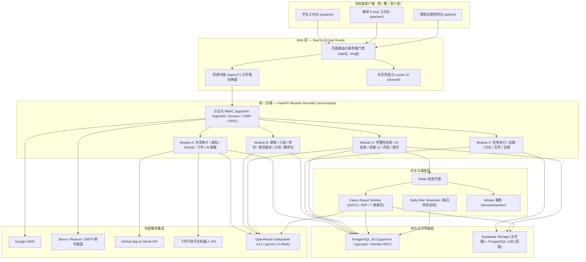
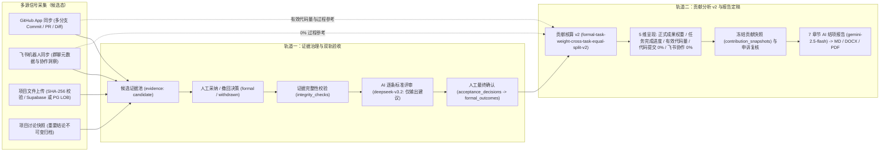

# 开发与架构设计

> 返回 [项目首页](../../README.md) · 另见 [本地开发、测试与部署指引](LOCAL_AND_DEPLOY.md) · 更新日期：2026-11-27

## 1. 技术栈概览

| 层级 | 技术选型与职责 |
| --- | --- |
| Web 前端 | Next.js 15 App Router、React 19、TypeScript、Tailwind CSS v4、Radix UI / shadcn 风格控件、Lucian UI 动效底座（`shared/styles/lux-*.css`、`shared/components/lux/`、`shared/auth/lux/`）、TanStack Query、next-intl（简体中文 / 繁體中文 / English） |
| 统一后端 | FastAPI、SQLAlchemy 2、Alembic（迁移目录 `services/api/migrations/`，当前迁移头 `0047`）、Pydantic v2、Argon2id 密码散列、HttpOnly 会话 Cookie + CSRF 校验、Google OIDC 登录与账号关联 |
| 数据与异步 | PostgreSQL **18.6**（Railway 托管，启用 `pgvector` 与 `pgcrypto`；本地 Docker Compose 使用 PG 16/18）、Redis、Celery Worker（`services/worker/` 及 `services/api` 的 `report-worker` / `risk-scheduler`） |
| 对象存储 | Supabase Storage（主存储）+ PostgreSQL LOB 回退（文件、证据附件、报告导出产物） |
| 外部集成 | GitHub App + OAuth（多分支 Commit / PR / Diff 同步）、飞书开放平台机器人（群聊元数据与 AI 协作洞察）、OpenRouter AI（日常分析 `deepseek/deepseek-v3.2` + 7 章节报告与图表 `google/gemini-2.5-flash`，写入 `a_ai_usage_events` 用量表）、Brevo / Resend / SMTP 学校邮箱验证码通道 |
| 部署与治理 | Railway 三环境部署（Staging `develop` / Production `main` / 独立双环境管理台 `admin-backend`）+ GitHub Actions 6 项 CI/CD 流水线 |

## 2. 系统总体架构



## 3. 双轨证据验收与贡献核算 v2 流程

GroupProof 将「外部研发/协作信号采集」与「人工确认的正式成果核算」严格分离：AI 仅输出结构化建议与证据引用，必须经过人工确认才能写入正式验收结果与贡献快照；贡献核算 v2（`formal-task-weight-cross-task-equal-split-v2`）综合呈现 5 个维度，其中代码提交次数与飞书群聊讨论权重固定为 `0%`（仅作过程参考，防止刷提交或水群扭曲分值）。



## 4. 仓库完整目录结构

```text
.
├── app/                     # Next.js App Router 路由入口、全局样式 (globals.css) 与 /api/v1 同源代理
├── student/                 # 学生工作台
│   ├── api/                 # 学生端 B/C 模块业务 API 客户端
│   ├── courses/             # 我的课程、邀请码入班、班内小组、课程资料只读页
│   ├── projects/            # 我的项目、独立项目/移入课程、总览、设置、需求基线、计划、任务、里程碑
│   ├── execution/           # 任务执行与验收标准、证据中心、GitHub/飞书协作洞察、文件预览与讨论
│   ├── review/              # 验收确认、贡献度分析 v2 图表、7 章节报告编辑与导出、风险与项目设置
│   └── ux/                  # 学生工作区导航与设置中心状态模型
├── teacher/                 # 教师 5-Hub 工作台（独立作用域 .gp-teacher-shell）
│   ├── api/                 # 教师班级、审批、申诉、公告、资料、报告、规则、助教权限客户端
│   ├── charts/              # 班级进度、里程碑时间线、风险矩阵与活跃排行图表
│   ├── components/          # TeacherClassLayout (5-Hub)、快速跳转器 (Cmd/Ctrl+K)、花名册与档案抽屉
│   ├── hooks/               # 助教细粒度权限 Hook (use-teacher-permissions)
│   └── pages/               # 跨班仪表盘、班级管理、组队广场、成员变更、通知与各中心页面
├── admin/                   # 管理员治理控制台（独立作用域 .gp-shell-admin）
│   ├── api/                 # 身份管理与平台治理 API 客户端
│   ├── components/          # 环境切换器（Staging / Production）与管理台基础样式组件
│   ├── lib/                 # 管理端运行环境状态辅助
│   └── pages/               # 平台总览、用户/教师审核、课程治理、审计日志、AI 用量与访问申请
├── shared/                  # 跨角色共享模块
│   ├── auth/                # 登录、注册资料补全、密码重置、账户中心、会话校验与 lux/ParticleWordmark
│   ├── components/          # WorkspaceShell、RouteDispatcher、通用组件、ui/ 基础控件与 lux/ 交互组件
│   ├── daily-inbox/         # 首页概览、个人动态、通知与待处理收件箱
│   ├── i18n/                # next-intl 配置、三语 messages/ 与中文 UI 翻译目录 catalog/
│   ├── lib/                 # 路由表 (routes.ts)、导航上下文、API 基础客户端与工具函数
│   ├── styles/              # Lucian UI 令牌与壳层样式 (lux-tokens/shell/student/teacher.css)
│   ├── types/               # 共享领域类型定义
│   └── legacy-mock/         # 隔离单测、路由自检与历史演示模式兼容夹具（Staging/Production 强制关闭）
├── services/
│   ├── api/                 # 统一 FastAPI 后端（auth + modules a/b/c/d + migrations 0001–0047 + pytest）
│   └── worker/              # Celery 异步任务框架与后台消费者
├── packages/domain/         # 后端导出的 OpenAPI 快照 (openapi.json) 与生成的 TS 类型 (api.generated.ts)
├── e2e/                     # Playwright 端到端测试套件（含教师工作台 t1–t5、学生与 C 真实 API 套件）
├── scripts/                 # 路由/i18n/UI/权限契约校验、API 客户端生成与 Railway 部署脚本
└── docs/                    # 架构设计、模块文档、测试报告与阶段记录
```

### 基础设施与部署路径边界

- 原早期实验性 `server/` 目录已退役移除，`services/api` 是唯一权威后端。
- `app/`、`services/`、`packages/domain/`、`Dockerfile`、`docker-compose.yml`、`.github/` 与 `scripts/deploy-*.mjs` 保持路径稳定，以兼容 Railway 三环境构建、Alembic `0047` 迁移检查与自动发布链路。

## 5. 核心领域与状态机不变量

1. **正式版本与草稿分离**
   - 课程规则、需求基线与任务计划均区分草稿态与冻结/发布版本；成员确认严格绑定具体版本号。
   - 写操作通过乐观锁 `lock_version` 与请求头 `Idempotency-Key` 防止并发覆盖与重复提交。
2. **候选证据与正式证据分离**
   - GitHub 多分支提交 / PR / CI、飞书讨论结论与项目文件版本先作为候选证据采集，经采纳进入正式证据，并按规则支持撤回或作废；证据变更在同事务中作废受影响的验收结论。
   - 外部集成未配置或不可用时明确展示不可用状态，绝不伪造或回退演示数据。
3. **任务与 AI 验收闭环**
   - 任务树、看板与列表共享同一份 Task 领域数据。
   - 进度达到 100% 不会自动提交任务；AI 验收通过后仍须人工确认方可进入最终完成态（`formal_outcomes`）。
4. **贡献核算 v2（`formal-task-weight-cross-task-equal-split-v2`）**
   - 正式贡献权重严格基于已人工确认的任务权重与跨任务分工核算，并支持冻结快照（`POST /api/v1/projects/{id}/contribution/freeze`）与申诉裁定。
   - 前端多维对比图提供 5 个维度：**正式成果权重**、**任务完成进度**、**有效代码量**、**代码提交（参考，0% 权重）**、**飞书协作（参考，0% 权重）**。
5. **独立项目「移入课程」互通流程**
   - 入口：学生项目总览/设置页与 `/projects` 页面「移入课程」操作 → `POST /api/v1/projects/{project_id}/attach-course`。
   - 鉴权与不变量：
     - 校验目标项目处于 `active` 态、尚未关联课程（否则 `409 PROJECT_ALREADY_IN_COURSE`），且调用者是有效项目组长（否则 `403 PROJECT_LEADER_REQUIRED`）。
     - 校验目标课程处于 `active` 态，且调用者是该课程的有效学生成员（否则 `403 COURSE_MEMBER_REQUIRED`）。
     - 小组解析：显式传入 `group_id` 或复用调用者在该课内的未立项小组时，均严格校验调用者为该小组组长（否则 `403 GROUP_LEADER_REQUIRED`）且小组无进行中项目（否则 `409 GROUP_HAS_PROJECT`）；若无小组则自动按项目名称创建唯一小组。
     - 成员与资产同步：若目标小组名单未冻结（`not roster_frozen`），自动将在课内且尚未入组的项目队友同步为小组成员（绝不移除原 `ProjectMember`）；完整保留原有计划、任务、证据、GitHub/飞书绑定与报告，并写入 `project.attached_to_course` 审计日志。
     - 互通效果：移入完成后，教师端 `/teacher/courses/{course_id}`、组队广场、项目列表与报告总览即刻可见该小组与项目进展。
6. **AI 用量透明治理与双模型路由**
   - 日常结构化分析（GitHub 提交摘要、证据匹配、飞书协作洞察、风险解读、需求/规划/验收）默认路由至 `deepseek/deepseek-v3.2`；7 章节结项报告撰写与图表规划路由至 `google/gemini-2.5-flash`。
   - 每次调用均记录至 `a_ai_usage_events`（含模型、场景、输入/输出 Token、延迟与费用），供 `/admin/ai-usage` 实时审阅；详细成本测算见 [并发压力测试与 AI 成本测算报告](../testing/STRESS_TEST_REPORT.md)。

## 6. API 与 OpenAPI 契约同步流程

`services/api` 是所有接口契约的唯一权威来源，CI 通过 `services/api/tests/test_openapi_snapshot.py` 与 `git diff --exit-code packages/domain/api.generated.ts` 强制校验前后端契约一致：

```bash
# 1. 修改 FastAPI 路由或 Pydantic Schema 后重新导出快照
cd services/api && PYTHONPATH=. python scripts/export_openapi.py

# 2. 在仓库根目录重新生成前端 TypeScript 接口定义
npm run api:generate
```

## 7. 延伸阅读

- [系统技术方案](../architecture/TECHNICAL_PLAN.md)
- [部署架构文档](../architecture/DEPLOYMENT.md)
- [数据库 ER 图与迁移清单](../architecture/ERD.md)
- [前端页面地图与路由规范](../architecture/FRONTEND_IMPLEMENTATION_PLAN.md)
- [前端实现状态](../../FRONTEND_STATUS.md)
- [并发压力测试与 AI 成本测算报告](../testing/STRESS_TEST_REPORT.md)
- [项目协作规范](../../AGENTS.md)
