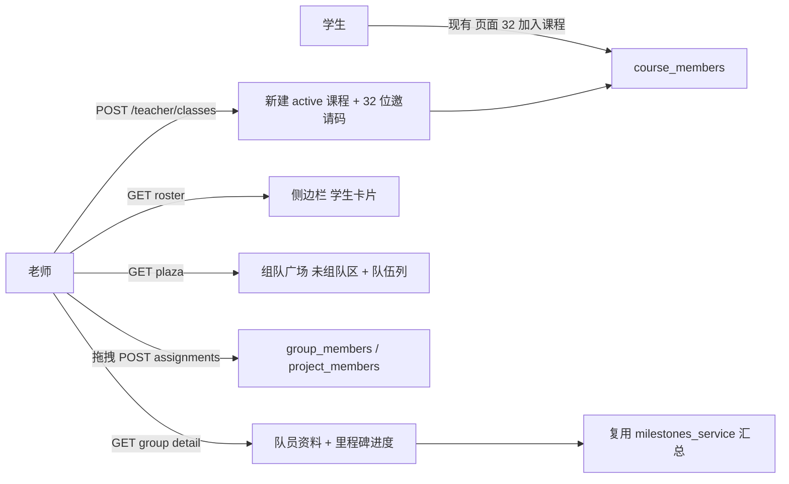

# 教师端深度开发执行计划：班级、邀请码、学生侧边栏、组队广场、队伍进度

> **历史归档文档**：本文记录对应阶段的规划/验收快照，不代表当前最新状态；当前架构、实时交付状态与限制请以 [README.md](../../../README.md) 与 [FRONTEND_STATUS.md](../../../FRONTEND_STATUS.md) 为准。

- 编写日期：2026-11-14
- 编写人：规划方（只负责规划，不写代码）
- 执行方：其他模型或开发者。请按本文顺序执行，每一步写完都要跑完验证再进入下一步。
- 状态：**已确认，待执行**

---

## 0. 执行前必读

### 0.1 仓库与分支状态

- 仓库根目录：`/Users/motasy_delay/GroupProof-team/groupproof`（下文简称 `<repo>`）。
- 当前分支是 `B_task`。工作区里已经合入了 `origin/develop`（`15f713f`），用的是 `git merge --no-commit`，**合并还没有提交**。
- 冲突已经全部解决并暂存。数据库迁移已经排到 `0031`（A 模块到 `0024`，B 模块是 `0025`–`0031`）。

### 0.2 硬性约束

1. **禁止** `git commit`、`git push`、`git merge --continue`、`git reset`、`git stash`、`git checkout -- <file>`，以及任何会改写分支或丢弃改动的命令。所有改动只留在工作区，由用户确认后自己提交。
2. **不新增数据库迁移**，只用现有表（见 §1.2）。如果确实发现非加表不可，先停下来说明原因，不要自己加。
3. **不修改邀请码格式或长度。** 继续使用 C 模块现有的 `secrets.token_urlsafe(24)`（32 位）和 `resolve_course_invite` 的现有校验，**不改 C 模块的任何代码**。
4. **不新增 npm 或 pip 依赖。** 拖拽用浏览器原生的 HTML5 Drag and Drop。
5. 代码风格和 B 模块现有代码保持一致：
   - 后端：`router` + `service` + `schemas` 三个文件；写操作走 `app.modules.b.common.run_command`（带幂等键）和 `require_version`（乐观锁）；错误统一抛 `ApiError`。
   - 前端：React Query 加 `features/b/` 下面的已有工具（`use-b-error.ts`、`ui.ts`），页面文案写简体中文源文本，用 `tr()` 或 JSX 自动翻译。
6. 后端运行 Python 时用虚拟环境里的命令：`<repo>/services/api/.venv/bin/python`、`.../pytest`、`.../ruff`。

### 0.3 已确认的需求决定

| 编号 | 决定 |
| --- | --- |
| D1 | “班级”**直接复用课程**（`courses`）。老师建的班级就是一门课程，学生继续用现有的“我的课程 / 加入课程”页面（31/32）。 |
| D2 | 邀请码**保持现有 32 位格式**。页面提供“复制邀请码”和“复制加入链接”两个按钮。 |
| D3 | 老师建班后**直接生效**（`status="active"`），同时生成邀请码。 |
| D4 | **已经立项的队伍（这个小组已有 `projects` 记录），队员不能被老师拖出或换到别的队。** 接口返回 `409 GROUP_HAS_PROJECT`，页面引导老师去现有的“成员变动”页面 48（`/teacher/courses/{cid}/member-changes`）走正式流程。拖**入**已立项的队伍是允许的，这时会同步写入项目成员。 |
| D5 | 老师可以**越过组队截止时间**分配学生；但队伍名单已冻结（`groups.roster_frozen = true`）时，老师也不能改。 |
| D6 | 组队广场里老师能做的事：新建空队伍；把未组队学生拖进队伍；在两个队伍之间换组（受 D4 限制）；把学生拖出队伍、变回未组队（受 D4 限制）；指定或更换队长。 |
| D7 | 侧边栏里老师能做的事：查看学生资料；把学生移出班级（只能移出未组队的学生）；重置邀请码；审批入班申请（复用现有接口）。 |
| D8 | 课程编号（`courses.code`）老师可以不填，不填时自动生成 `CLS-XXXXXX`（6 位大写字母和数字，保证不重复）。 |
| D9 | 进度算法：队伍卡片显示“已完成里程碑 / 总数”和整体进度。整体进度 = 有关联任务的里程碑的 `progress_percent` 取平均，四舍五入成整数。卡片还要显示下一个里程碑、逾期数量和风险等级。没有项目时显示“尚未立项”，没有里程碑时显示“暂无里程碑”，**都不显示 0%**。 |

---

## 1. 背景：可以复用的现有代码

### 1.1 后端

| 能力 | 位置 | 怎么用 |
| --- | --- | --- |
| 课程模型 | `services/api/app/db/models/core.py` 里的 `Course`（约第 196 行） | 建班时插入一行 |
| 邀请码模型 | `services/api/app/modules/c/governance_models.py` 里的 `CourseInvite`（`course_id` 是主键，`code` 唯一，另有 `revoked_at`） | 建班时插入；重置时改 `code` |
| 课程编号登记、建课历史 | `governance_course_service.reserve_code(session, code, course_id)`、`course_data(row)`；`governance_models.CourseLifecycleDecision` | 建班时调用和写入，保持 C 的历史完整 |
| 教师资格检查 | `governance_course_service.require_teacher(session, teacher_id)`：账号在职、身份是教师、学校邮箱已验证 | 建班前调用 |
| 权限 | `app.modules.a.permissions` 里的 `require_course_teacher`、`require_course_staff`、`is_course_teacher`、`require_active` | 每个接口的入口都要调用 |
| 审计、通知 | `app.modules.a.audit.record_audit`、`app.modules.a.inbox.notify` | 每个写操作都要调用 |
| 入班方式 | `app.modules.b.courses_service.set_join_policy` / `get_join_policy` / `join_mode`，以及 `list_join_requests` / `decide_join` | 建班时设置；侧边栏读取待审批申请 |
| 入组检查 | `app.modules.b.groups_service._add_member(session, group, course, user_id, check_deadline=...)`：防止重复入组、检查满员和截止时间，并同步写 `project_members` | 老师分配时传 `check_deadline=False` |
| 小组辅助函数 | `groups_service._group(session, gid, lock=)`、`_members`、`_member_count`、`_group_of`、`_person` | 复用 |
| 里程碑进度 | `app.modules.b.milestones_service`：`_milestones`、`_facts`、`_values`、`_linked`、`_deliverable_counts`、`_risks`、`_risk_tasks`、`_brief`；对外接口是 `list_milestones` | 计算队伍进度时复用，**不要另写一套算法** |
| 写操作框架 | `app.modules.b.common`：`run_command`、`require_version`、`require_reason`、`now`、`envelope`、`private_response` | 复用 |
| 路由入口 | `app.modules.b.router` 里统一 `include_router(..., prefix="/api/v1")` | 在这里挂新路由 |

> 以 `_` 开头的是模块内部函数。复用时**直接导入**即可，不要复制一份。如果函数名不合适，可以在原模块里加一个不带下划线的公开别名，但**不要改原函数的行为**。

### 1.2 会用到的表（全部已存在，不新增迁移）

`courses`、`c_course_invites`、`c_course_code_registry`、`c_course_lifecycle_decisions`、`course_members`、`groups`、`group_members`、`projects`、`project_members`、`milestones`、`tasks`、`task_milestones`、`b_command_receipts`、`b_course_join_requests`、`b_course_join_policies`（入班方式表的实际表名以代码为准）。

### 1.3 前端

| 位置 | 现状 |
| --- | --- |
| `lib/routes.ts` | 教师页面 41–50 已经有路径：`/teacher/courses/{cid}`（41）、`/groups`（42）、`/groups/{gid}`（43）、`/member-changes`（48）等 |
| `features/route-dispatcher.tsx` | 按 `apiMode("bworkspace") === "real"` 决定挂真实页面还是演示页面；用 `screen >= 51 ? "admin" : screen >= 41 ? "teacher" : "student"` 判断外壳类型 |
| `features/b/screens.ts` | `bScreens` 列表 |
| `features/governance/TeacherViews.tsx` | 41/42/43 的**演示数据**版本，真实模式下不再使用，**不要删** |
| `lib/api/client.ts` | `createApiClient`、`createSessionFetch`（写请求自动带 CSRF 令牌） |
| `packages/domain/api.generated.ts` | 由 OpenAPI 自动生成的类型 |
| `lib/i18n/tr.ts`、`lib/i18n/catalog/en.ts`、`zh-Hant.ts` | 界面文案翻译表：简体中文原文作为键 |
| `features/b/*.tsx` | 写法参考，例如 `GroupsApiPages.tsx`、`MilestonesApiPage.tsx` |

---

## 2. 总体设计



---

## 3. 第 1 步：后端接口（B 模块）

### 3.1 新增文件

- `services/api/app/modules/b/teacher_classes_schemas.py`
- `services/api/app/modules/b/teacher_classes_service.py`
- `services/api/app/modules/b/teacher_classes_router.py`

修改 `services/api/app/modules/b/router.py`：

```python
from app.modules.b.teacher_classes_router import router as teacher_classes_router
...
router.include_router(teacher_classes_router, prefix="/api/v1")
```

### 3.2 接口一览

所有接口都在 `/api/v1` 下，返回体统一用 B 的 `envelope`，即 `{"data": ..., "meta": {...}}`。写接口要求请求头带 `Idempotency-Key`，取法和 B 现有路由一样（参考 `groups_router.py`）。

| # | 方法 | 路径 | 请求体 | 返回 data | 权限 |
| --- | --- | --- | --- | --- | --- |
| 1 | GET | `/teacher/classes?tab=active\|ended\|all&q=` | — | `TeacherClassPageDTO` | 在职教师（`global_role in {teacher, ta}`）；只返回本人是课程创建者或课程教职成员的班级 |
| 2 | POST | `/teacher/classes` | `CreateClass` | `ClassDetailDTO`（201） | `require_teacher(session, user.id)` |
| 3 | GET | `/teacher/classes/{cid}` | — | `ClassDetailDTO` | `require_course_staff` |
| 4 | POST | `/teacher/classes/{cid}/invite-code/rotate` | `RotateInvite{expected_version:int}` | `ClassDetailDTO` | `require_course_teacher` |
| 5 | GET | `/teacher/classes/{cid}/roster?q=&status=all\|grouped\|ungrouped` | — | `RosterDTO` | `require_course_staff` |
| 6 | POST | `/teacher/classes/{cid}/students/{uid}/remove` | `RemoveStudent{reason:str}` | `RosterStudentDTO`（移出后的状态） | `require_course_teacher` |
| 7 | GET | `/teacher/classes/{cid}/plaza` | — | `PlazaDTO` | `require_course_staff` |
| 8 | POST | `/teacher/classes/{cid}/groups` | `TeacherCreateGroup{name, direction?}` | `PlazaGroupDTO`（201） | `require_course_teacher` |
| 9 | POST | `/teacher/classes/{cid}/assignments` | `Assign` | `AssignResultDTO` | `require_course_teacher` |
| 10 | POST | `/teacher/classes/{cid}/groups/{gid}/leader` | `SetLeader{user_id, expected_version}` | `PlazaGroupDTO` | `require_course_teacher` |
| 11 | GET | `/teacher/classes/{cid}/groups/{gid}` | — | `TeacherGroupDetailDTO` | `require_course_staff` |

通用规则：

- 课程不存在，或者 `gid` 不属于 `cid` → `404 COURSE_NOT_FOUND` / `404 GROUP_NOT_FOUND`。
- 不是本课的教职成员 → 由 `permissions` 抛 403。
- 写操作要求课程状态是 `active`，否则返回 `409 COURSE_NOT_ACTIVE`。
- GET 接口调用 `private_response(response)`，禁止缓存。

### 3.3 数据结构（`teacher_classes_schemas.py`）

```python
from datetime import datetime
from typing import Literal
from uuid import UUID
from pydantic import AwareDatetime, BaseModel, Field, model_validator

class CreateClass(BaseModel):
    name: str = Field(min_length=1, max_length=200)
    semester: str = Field(min_length=1, max_length=64)
    college: str = Field(min_length=1, max_length=160)
    code: str | None = Field(None, max_length=64, pattern=r"^[A-Za-z0-9][A-Za-z0-9_-]*$")
    project_deadline: AwareDatetime
    formation_deadline: AwareDatetime | None = None
    min_group_size: int = Field(1, ge=1, le=50)
    max_group_size: int = Field(6, ge=1, le=50)
    join_mode: Literal["direct", "approval"] = "direct"   # 取值以 courses_service.join_mode 现有取值为准
    # 校验：min<=max；project_deadline 晚于现在；formation_deadline<=project_deadline

class RotateInvite(BaseModel):
    expected_version: int

class RemoveStudent(BaseModel):
    reason: str = Field(min_length=1, max_length=500)

class TeacherCreateGroup(BaseModel):
    name: str = Field(min_length=1, max_length=160)
    direction: str | None = Field(None, max_length=200)

class Assign(BaseModel):
    student_id: UUID
    to_group_id: UUID | None          # None 表示移出队伍
    from_group_version: int | None = None   # 学生当前在某个队伍里时必填
    to_group_version: int | None = None     # to_group_id 不为空时必填
    reason: str | None = Field(None, max_length=500)

class SetLeader(BaseModel):
    user_id: UUID
    expected_version: int

class GroupRefDTO(BaseModel):
    id: UUID; name: str

class TeacherClassSummaryDTO(BaseModel):
    id: UUID; code: str; name: str; semester: str; college: str; status: str
    student_count: int; group_count: int; ungrouped_count: int
    pending_join_count: int; href: str        # /teacher/courses/{id}

class TeacherClassPageDTO(BaseModel):
    items: list[TeacherClassSummaryDTO]
    counts: dict[str, int]                    # all / active / ended

class ClassDetailDTO(TeacherClassSummaryDTO):
    invite_code: str | None                   # 没有邀请码或已撤销时为 None
    join_url: str | None                      # /courses/join?code=<invite_code>
    join_mode: str
    project_deadline: datetime | None
    formation_deadline: datetime | None
    min_group_size: int; max_group_size: int
    lock_version: int
    can_manage: bool                          # 本课老师为 true，助教为 false

class RosterStudentDTO(BaseModel):
    id: UUID
    name: str | None
    student_number: str | None
    email: str | None
    initial: str                               # 姓名首字；没有姓名时取邮箱首字母，转大写
    joined_at: datetime
    status: Literal["grouped", "ungrouped", "left"]
    group: GroupRefDTO | None
    is_leader: bool
    in_project_group: bool                     # 所在队伍已立项时为 true（D4）

class RosterDTO(BaseModel):
    items: list[RosterStudentDTO]
    counts: dict[str, int]                     # all / grouped / ungrouped
    pending_join_count: int

class MilestoneRefDTO(BaseModel):
    id: UUID; title: str; deadline: datetime | None; href: str

class GroupProgressDTO(BaseModel):
    state: Literal["no_project", "no_milestones", "tracking"]
    milestones_total: int
    milestones_completed: int
    overall_percent: int | None
    next_milestone: MilestoneRefDTO | None
    overdue_count: int
    risk_level: Literal["low", "medium", "high"] | None

class PlazaMemberDTO(BaseModel):
    id: UUID; name: str | None; student_number: str | None; initial: str; is_leader: bool

class PlazaGroupDTO(BaseModel):
    id: UUID; name: str; direction: str | None
    leader_id: UUID | None
    members: list[PlazaMemberDTO]
    member_count: int; max_group_size: int
    roster_frozen: bool
    has_project: bool
    project: dict | None                       # {id, name, href:/projects/{id}}
    lock_version: int
    accepts_drop: bool                         # 没满员且名单没冻结
    locked_reason: str | None                  # 例如“已满员”“名单已冻结”
    members_locked: bool                       # 已立项时为 true：队员不能拖出（D4）
    progress: GroupProgressDTO
    href: str                                  # /teacher/courses/{cid}/groups/{gid}

class PlazaDTO(BaseModel):
    course_id: UUID
    groups: list[PlazaGroupDTO]
    ungrouped: list[PlazaMemberDTO]
    formation_deadline: datetime | None
    formation_open: bool
    can_manage: bool

class AssignResultDTO(BaseModel):
    student_id: UUID
    from_group: PlazaGroupDTO | None
    to_group: PlazaGroupDTO | None

class TeacherGroupMemberDTO(BaseModel):
    id: UUID; name: str | None; student_number: str | None; email: str | None
    role: Literal["leader", "member"]; joined_at: datetime; open_task_count: int

class TeacherGroupDetailDTO(BaseModel):
    group: PlazaGroupDTO
    members: list[TeacherGroupMemberDTO]
    milestones: list[...]   # 直接复用 milestones_schemas.MilestoneDTO
    member_changes_href: str  # /teacher/courses/{cid}/member-changes
```

### 3.4 业务逻辑（`teacher_classes_service.py`）

#### 3.4.1 `list_classes(session, user, tab, q)`

- `permissions.require_active(user)`；`global_role` 不是 `teacher` 或 `ta` 时返回 403。
- 查询“我的班级”：`Course.owner_id == user.id`，或者课程教职表（A 的 `CourseStaff`，导入路径以 `permissions.py` 里的为准）中本人记录的 `left_at is null`。
- 统计时**批量**分组查询，不要每门课单独查（避免 N+1）：
  - 学生数：`course_members` 中 `role='student'` 且 `left_at is null`；
  - 队伍数：`groups` 按 `course_id` 计数；
  - 未组队人数 = 学生数减去在本课某个队伍里（`group_members.left_at is null`）的学生数；
  - 待审批入班申请数：`b_course_join_requests` 中 `status='pending'` 的记录数。

#### 3.4.2 `create_class(session, user, cmd, request)`

```python
def create_class(session, user, cmd, request):
    require_teacher(session, user.id)                 # 复用 C 的检查
    code = (cmd.code or _auto_course_code(session)).strip()
    # 编号重复时由 reserve_code 抛 409 COURSE_CODE_CONFLICT
    course = Course(id=uuid4(), owner_id=user.id, code=code, name=cmd.name.strip(),
                    college=cmd.college.strip(), semester=cmd.semester.strip(),
                    project_deadline=cmd.project_deadline, formation_deadline=cmd.formation_deadline,
                    grouping_mode="free", min_group_size=cmd.min_group_size,
                    max_group_size=cmd.max_group_size, status="active", lock_version=0)
    session.add(course); session.flush()
    reserve_code(session, course.code, course.id)
    session.add(CourseLifecycleDecision(course_id=course.id, actor_id=user.id, version_no=0,
        action="create", reason="教师创建班级", before_json={}, after_json=course_data(course)))
    session.add(CourseInvite(course_id=course.id, code=secrets.token_urlsafe(24), created_by=user.id))
    # 入班方式：调用 courses_service 现有的写入函数，或者直接写它的表；
    # 必须和 set_join_policy 写入的效果一致
    _apply_join_mode(session, course, cmd.join_mode, user)
    record_audit(session, actor=user, action="class.created", target=("course", course.id),
                 course_id=course.id, after={"code": course.code, "name": course.name}, request=request)
    session.flush()
    return class_detail(session, user, course)
```

- `_auto_course_code`：`"CLS-" + 6 位字符`，字符集用 `ABCDEFGHJKLMNPQRSTUVWXYZ23456789`。用 `func.lower(func.trim(Course.code))` 和 `CourseCodeRegistry` 查重；重复就重新生成，最多试 10 次，还不行就返回 `409 COURSE_CODE_CONFLICT`。
- `CourseLifecycleDecision` 的 `action` 只能是 `create`、`publish`、`end`，这里用 `create` 就够了。课程直接是 `active`，**不再补一条 `publish`**。在代码注释里写明原因：这是教师建班，没有走发布流程。
- 接口外面套 `run_command(operation="teacher.class.create", status_code=201)`。

#### 3.4.3 `class_detail(session, user, course)` / `get_class`

- `invite_code`：如果 `CourseInvite` 存在且 `revoked_at is None`，返回它的 `code`，否则返回 `None`；`join_url = f"/courses/join?code={code}"`。
- `can_manage = permissions.is_course_teacher(session, user, course.id)`。

#### 3.4.4 `rotate_invite(session, user, cid, cmd, request)`

1. `require_course_teacher`；锁住课程行（`with_for_update`），然后 `require_version(course.lock_version, cmd.expected_version)`。
2. 锁住 `CourseInvite`：
   - 没有这一行就新建；
   - 有就把 `code` 改成新的 `secrets.token_urlsafe(24)`，`revoked_at=None`，`created_by=user.id`，`created_at=now()`。
3. 课程的 `lock_version` 加 1，`updated_at=now()`。
4. 写审计 `class.invite_rotated`，**审计内容里不要写新旧邀请码的明文**。
5. 套 `run_command(operation=f"teacher.class.rotate:{cid}")`。

#### 3.4.5 `roster(session, user, cid, q, status)`

- `require_course_staff`。
- 一次查出 `course_members` 中 `role='student'` 且 `left_at is null` 的学生，连同 `User` 信息，左连接当前小组成员关系和小组，再标出所在小组是否已有 `Project`（一次查询或两次批量查询完成）。
- `q` 按姓名、学号、邮箱模糊匹配（不区分大小写），`status` 按已组队或未组队过滤。
- 排序：未组队的在前，然后按姓名、id。
- 邮箱：老师和助教可以看到完整邮箱（本课教职成员本来就能看本课学生信息）。如果 A 有现成的脱敏函数，按 A 的规则处理。

#### 3.4.6 `remove_student(session, user, cid, uid, cmd, request)`

1. `require_course_teacher`；锁住课程行和这位学生的 `course_members` 行（必须是 `role='student'` 且 `left_at is null`，否则 404 `STUDENT_NOT_FOUND`）。
2. 如果学生在本课某个队伍里 → `409 STUDENT_IN_GROUP`，提示：“请先在组队广场把该学生移出队伍”。
3. 设置 `left_at=now()`、`status="left"`，`lock_version` 加 1。
4. 写审计 `class.student_removed`，带上原因。用 `notify` 通知这位学生，`category="course"`，`target={"kind":"course","id":cid,"course_id":cid}`。
5. 关掉这位学生在本课里还没处理的待办（如果有对应的 `source_key`，用 `close_action_items_by_source`；没有就跳过）。
6. 学生之后可以凭邀请码重新加入，依赖现有的唯一索引 `uq_course_members_current`（只约束 `left_at is null` 的记录）。

#### 3.4.7 `plaza(session, user, cid)`

- `require_course_staff`。
- 批量查询本课的全部队伍和当前队员（`left_at is null`），以及每个队伍的项目（`Project.group_id`，只算 `archived_at is null` 的）。
- 未组队学生的查法和 roster 一样。
- 每个队伍的 `progress` 由 §3.4.10 批量算出。
- `accepts_drop = not roster_frozen and member_count < course.max_group_size and course.status == "active"`。
- `members_locked = has_project or roster_frozen`。
- `formation_open` 用 `groups_service.formation_open(course)` 判断。

#### 3.4.8 `create_group(session, user, cid, cmd, request)`

- `require_course_teacher`；锁住课程行；课程必须是 `active`。
- 队名去掉首尾空格后，和本课已有队名重复 → `409 GROUP_NAME_TAKEN`。数据库里还有唯一约束 `uq_groups_course_name` 兜底：给 `run_command` 传 `integrity_error=ApiError(409,"GROUP_NAME_TAKEN",...)`。
- 插入 `ProjectGroup(course_id=cid, name=..., direction=..., leader_id=None)`，然后写审计 `group.teacher_created`。

#### 3.4.9 `assign(session, user, cid, cmd, request)`（核心）

```text
1. require_course_teacher；锁住课程行（with_for_update）；课程必须是 active。
2. 锁住学生的 course_members 行（role='student'、left_at is null），找不到 → 404 STUDENT_NOT_FOUND。
3. src = groups_service._group_of(session, student_id, cid)   # 学生当前所在队伍，可能为 None
   dst = cmd.to_group_id
   - src 和 dst 是同一个队伍 → 直接返回当前状态（什么都不改）
   - src 和 dst 都为空 → 同样直接返回
4. 按 UUID 字符串排序，依次锁住 src 和 dst 两个小组（groups_service._group(..., lock=True)），
   防止两个操作互相卡死。dst 必须属于 cid，否则 404 GROUP_NOT_FOUND。
5. 版本核对：
   - 有 src 时，from_group_version 必须填写，并且等于 src.lock_version，否则 409 VERSION_CONFLICT
   - 有 dst 时，to_group_version 必须填写，并且等于 dst.lock_version
6. 离开 src（有 src 时）：
   - src.roster_frozen → 409 ROSTER_FROZEN
   - src 已有项目（Project.group_id == src.id）→ 409 GROUP_HAS_PROJECT，
       details={"group_id": src.id, "member_changes_href": f"/teacher/courses/{cid}/member-changes"}
       （D4：已立项的队员不能被强制拖出或换组）
   - 否则：这位学生在 group_members 里的当前记录写 left_at=now()；
       如果 src.leader_id == student_id，就把 src.leader_id 设为 None，
       并且把剩下队员里 role='leader' 的记录改成 'member'（以 groups_service._set_leader 的现有写法为准）
7. 进入 dst（有 dst 时）：
   - dst.roster_frozen → 409 ROSTER_FROZEN
   - 调用 groups_service._add_member(session, dst, course, student_id, check_deadline=False)
     （它会检查 ALREADY_IN_GROUP 和 GROUP_FULL，并在 dst 已立项时同步写 project_members）
8. src 和 dst 的 lock_version 各加 1，updated_at=now()，然后 session.flush()。
9. 写审计 action="group.teacher_assign"，target=("course", cid)，
     after={"student_id", "from_group_id", "to_group_id"}，reason=cmd.reason。
10. 通知：
    - 学生：标题“老师已将你分配到「{dst.name}」”，或“老师已将你移出「{src.name}」”
    - dst 的队长（如果有，且不是这位学生本人）：标题“老师将 {name} 分配进了你的小组”
    - dedupe_key 写成 f"b:teacher-assign:{student_id}:{src_id}:{dst_id}:{dst_version}"
11. 返回 AssignResultDTO：src 和 dst 都要重新计算一遍 PlazaGroupDTO。
```

- 外面套 `run_command(operation=f"teacher.assign:{cid}", payload=cmd.model_dump(mode="json"), integrity_error=ApiError(409, "CONCURRENT_WRITE_CONFLICT", ...))`。
- **并发要求**：队伍只剩一个名额时，两个请求同时分配不同的学生进去，只能成功一个，另一个返回 `GROUP_FULL` 或 `VERSION_CONFLICT`。

#### 3.4.10 `group_progress_map(session, groups) -> dict[group_id, GroupProgressDTO]`

- 找出每个队伍的项目。没有项目的队伍：`state="no_project"`，其余字段为 0 或 `None`。
- 有项目时，对每个项目复用 `milestones_service` 的内部函数，算出和 `list_milestones` 里**完全相同**的 `MilestoneDTO` 列表。建议在 `milestones_service.py` 里新加一个公开函数 `milestone_briefs(session, project_id) -> list[MilestoneDTO]`，**只做权限之外的计算**；然后让原来的 `list_milestones` 也改成调用它，保证两边结果一致。
- 汇总规则：
  - `milestones_total = len(items)`；为 0 时 `state="no_milestones"`
  - `milestones_completed`：`status == "completed"` 的个数
  - `overall_percent`：`task_count > 0` 且 `progress_percent is not None` 的里程碑取平均，四舍五入；一个都没有时为 `None`
  - `next_milestone`：没完成的里程碑里截止日期最早的一个（截止日期为空的排最后）；没有就为 `None`
  - `overdue_count`：`overdue` 为真的个数
  - `risk_level`：所有 `item.risk.level` 里最高的一级（high > medium > low），没有就为 `None`
- 广场接口要一次性计算所有队伍。可以接受每个项目查一次（一个班的队伍通常不超过 20 个），但**不能在循环里对每个任务再单独查询**。

#### 3.4.11 `set_leader(session, user, cid, gid, cmd, request)`

- `require_course_teacher`；锁住小组行；`require_version(group.lock_version, cmd.expected_version)`；名单已冻结 → `409 ROSTER_FROZEN`。
- `cmd.user_id` 必须是这个小组的当前队员，否则 `422 NOT_GROUP_MEMBER`。
- 调用 `groups_service._set_leader(session, group, cmd.user_id)`，它会同时更新 `group_members.role`、`groups.leader_id`，以及项目成员的角色（以现有实现为准）。`lock_version` 加 1。
- 写审计 `group.teacher_set_leader`，通知新旧两位队长。

#### 3.4.12 `group_detail(session, user, cid, gid)`

- `require_course_staff`；这个小组必须属于 `cid`。
- 队员信息参考 roster。`open_task_count` 用 `membership_service._open_tasks(session, projects, member_id)` 统计。
- `milestones` 直接用 `milestone_briefs(session, project_id)`；没有项目时返回 `[]`。

### 3.5 路由（`teacher_classes_router.py`）

- `router = APIRouter(tags=["b-teacher-classes"])`。
- 每个 handler 都用 `Depends(get_current_user)` 和 `Depends(get_session)`。写接口从 `Header(alias="Idempotency-Key")` 读取幂等键，读取方式参考 `groups_router.py`。
- 用 `response_model` 声明返回类型（或者沿用 B 现有路由的写法），让 OpenAPI 生成完整的类型。

### 3.6 第 1 步的验收

- `ruff check` 和 `ruff format --check` 通过。
- 新测试文件通过（§7.1）。

---

## 4. 第 2 步：OpenAPI 与生成类型

```bash
cd <repo>/services/api && .venv/bin/python scripts/export_openapi.py
cd <repo> && npm run api:generate
```

- 如果从仓库根目录运行导出脚本时报 `ModuleNotFoundError: app`，一定要先 `cd services/api` 再运行。**不要修改** `export_openapi.py`。
- 生成后跑一次 `.venv/bin/pytest tests/test_openapi_snapshot.py`，确认通过。

---

## 5. 第 3 步：前端

### 5.1 路由与外壳

**`lib/routes.ts`**

```diff
 const staticRoutes: Record<string, number> = {
   ...
   "/courses/join": 32,
+  "/teacher/courses": 57,
   "/admin/users": 51,
```

同时导出：

```ts
export const teacherScreens = [41, 42, 43, 44, 45, 46, 47, 48, 49, 50, 57] as const;
export function isTeacherScreen(screen: number) { return (teacherScreens as readonly number[]).includes(screen); }
```

如果 `classifyPath` 或 `check:e2e` 脚本对页面编号范围有假设，要一起更新，保证 `npm run check:e2e` 仍然通过。

**`features/route-dispatcher.tsx`**

- 把 `const kind = screen >= 51 ? "admin" : screen >= 41 ? "teacher" : "student";` 改成：`isTeacherScreen(screen) ? "teacher" : screen >= 51 ? "admin" : screen >= 41 ? "teacher" : "student"`。
- 在 `isBScreen(screen) && apiMode("bworkspace") === "real"` 这个分支里加：

```tsx
else if (screen === 57) realContent = <TeacherClassesApiPage />;
else if (screen === 41 && courseId) realContent = <TeacherClassLayout courseId={courseId}><TeacherClassHomeApiPage courseId={courseId} /></TeacherClassLayout>;
else if (screen === 42 && courseId) realContent = <TeacherClassLayout courseId={courseId}><TeamPlazaApiPage courseId={courseId} /></TeacherClassLayout>;
else if (screen === 43 && courseId && groupId) realContent = <TeacherClassLayout courseId={courseId}><TeacherGroupDetailApiPage courseId={courseId} groupId={groupId} /></TeacherClassLayout>;
```

- 演示模式下，页面 57 显示“需要真实接口模式”的空状态，可以复用 `BNotConnectedPage`。

**`features/b/screens.ts`**：`bScreens` 里加上 `41, 42, 43, 57`。

**`components/workspace-shell.tsx`**：教师导航里加“我的班级”，链接到 `/teacher/courses`，放在最前面。

### 5.2 API 客户端

新增 `lib/api/teacher-client.ts`：

- 基于 `createApiClient()`，每个接口一个函数，类型来自 `packages/domain/api.generated.ts`。
- 写接口自动生成 `Idempotency-Key`（`crypto.randomUUID()`），写法参考 `features/b/` 里现有的写请求。同一次用户操作重试时要用**同一个**键，失败后重新提交才换新键。
- 统一的错误类型和 B 现有的 `use-b-error.ts` 兼容，可以拿到 `code`、`message`、`details`。
- 导出 React Query 的键工厂：`teacherKeys.classes()`、`.class(cid)`、`.roster(cid)`、`.plaza(cid)`、`.group(cid, gid)`。

### 5.3 页面 57：`features/teacher/TeacherClassesApiPage.tsx`

- 页头“我的班级”，加一个“创建班级”按钮。
- 标签页：进行中 / 已结束 / 全部，再加一个搜索框，筛选条件写进 URL，复用 `useUrlQuery` 或 `use-url-filters`。
- 班级卡片：名称、编号、学期、学生数、未组队人数（大于 0 时高亮）、待审批人数、“进入班级”链接（`href`）。
- 创建班级用对话框或页内表单，字段与 `CreateClass` 一一对应：
  - 编号旁边写提示“留空自动生成”；
  - 入班方式用单选：“凭邀请码直接加入 / 需要老师审批”；
  - 提交前在前端校验人数上下限和截止时间；
  - 提交中禁用按钮；失败时保留已填内容，并显示后端错误（字段错误显示在对应字段下）。
- 创建成功后显示**邀请码卡片**，组件名 `InviteCodeCard`，放在 `features/teacher/InviteCodeCard.tsx`，供别处复用：
  - 等宽字体显示邀请码，太长时可以换行；
  - “复制邀请码”“复制加入链接”两个按钮，链接是 `location.origin + join_url`，复制成功后用 `role="status"` 提示“已复制”；
  - 下面放“进入班级”按钮。

### 5.4 共用布局与侧边栏

新增 `features/teacher/TeacherClassLayout.tsx`：

- 宽屏时用 `grid grid-cols-[300px_1fr]`，窄屏时侧边栏变成可以折叠的抽屉。
- 顶部：班级名称，加 3 个导航标签：班级首页（41）/ 组队广场（42）/ 成员变动（48，链到现有页面）。

新增 `features/teacher/ClassRosterSidebar.tsx`：

- 数据来自 `GET roster`，用 React Query，30 秒自动刷新一次，窗口重新获得焦点时也刷新。
- 顶部：
  - 精简版 `InviteCodeCard`，只放复制按钮；
  - “重置邀请码”按钮，只有 `can_manage` 时显示。点击后弹确认框：“旧邀请码会立即失效，已经入班的学生不受影响”；
  - 待审批入班申请的数量，链到 `/teacher/courses/{cid}/member-changes`。
- 搜索框，加“全部 / 已组队 / 未组队”的分段筛选，各自带数量。
- 学生卡片组件 `StudentEntity`：
  - 圆形首字头像、姓名、学号、状态标签：已组队显示绿色“已组队 · 队名”，加队长标记；未组队显示灰色“未组队”；
  - `draggable={can_manage && !in_project_group}`。`onDragStart` 时写入 `dataTransfer.setData("application/x-gp-student", JSON.stringify({studentId, fromGroupId, fromGroupVersion}))`；
  - 已立项的学生不能拖动，鼠标悬停时提示“该队伍已立项，请通过成员变动调整”。
- 点击卡片打开资料抽屉 `StudentProfileDrawer`：
  - 显示姓名、学号、邮箱、入班时间、所在队伍（可以点进页面 43）；
  - “移出班级”按钮：已组队时禁用，并说明原因。未组队时点击会弹出带原因输入框的确认框，成功后刷新 roster 和 plaza。
- 无障碍：侧边栏用 `<aside aria-label="班级学生">`，列表用 `<ul>`，每张卡片可以用 Tab 选中、用 Enter 打开抽屉。

### 5.5 页面 41：`features/teacher/TeacherClassHomeApiPage.tsx`

- 完整版 `InviteCodeCard`，加班级基本信息：学期、截止时间、人数上下限、入班方式。
- 4 张统计卡：学生数、队伍数、未组队人数、待审批人数。
- “队伍进度一览”：每支队伍一行，显示名称、进度条（或“尚未立项 / 暂无里程碑”）、下一个里程碑、逾期和风险标签，可以点进页面 43。
- 数据来自 `GET class` 和 `GET plaza`，复用同一个 plaza 查询键。

### 5.6 页面 42：`features/teacher/TeamPlazaApiPage.tsx`（组队广场）

**布局**

- 顶部工具栏：
  - 统计：“未组队 N 人 · 共 M 队 · 组队截止 {日期或‘未设置’}（已截止时加标签‘已截止，仅老师可分配’）”；
  - “新建队伍”按钮，只有 `can_manage` 时显示，点开一个小表单，填队名和方向。
- 左边一栏是“未组队学生”放置区，竖向列出学生卡片（复用 `StudentEntity` 的样式）。
- 右边是队伍卡片网格（`grid-cols-1 md:grid-cols-2 xl:grid-cols-3`）。每张卡片 `TeamCard` 包含：
  - 队名、方向，显示“`member_count/max_group_size`”；
  - 标签：“已立项”（`has_project`）、“名单已冻结”、“已满员”；
  - 队员列表：队长放第一个，带队长标记。每个队员有一个小菜单，里面有“设为队长”和“分配到…”；
  - 进度区 `GroupProgressBar`：
    - `tracking` 状态显示进度条、整体进度 %、“已完成 X/Y 个里程碑”、“下一个：{标题} · {日期}”，还有逾期和风险标签；
    - `no_project` 显示“尚未立项”；`no_milestones` 显示“暂无里程碑”；
  - 卡片底部有“查看详情”，进入页面 43。

**拖拽（HTML5 原生）**

- 拖动源：未组队区和各队伍里 `draggable` 的学生卡片。已立项队伍的队员，以及只读的助教，都不能拖。
- 放置目标：每张 `TeamCard`，加上未组队区。
  - `onDragOver`：读取当前拖动的数据（拖动开始时存进 React 状态，因为 `dragover` 事件里拿不到 `dataTransfer` 的内容），判断能不能放：目标是不是 `accepts_drop`、是不是来源队伍本身、来源是不是 `members_locked`。能放才 `preventDefault()`，并加高亮边框；不能放就让卡片变灰，并显示 `locked_reason`。
  - `onDrop`：调用 `assign`。请求里带上 `from_group_version` 和 `to_group_version`（取自当前 plaza 数据）。拖到未组队区时 `to_group_id=null`。
- 提交过程：
  - **不要先改界面再回滚**。提交期间，被拖的学生卡片显示“保存中…”且不能再拖；
  - 成功后用返回的 `from_group` 和 `to_group` 更新 plaza 缓存（`queryClient.setQueryData`），同时让 roster 缓存失效重新拉取；
  - 用 `aria-live="polite"` 区域播报“已将 X 分配到 Y”。
- 错误处理（显示在页面顶部的提示条里，可以关闭）：

| code | 提示文案 | 附加操作 |
| --- | --- | --- |
| `GROUP_HAS_PROJECT` | “该队伍已立项，不能直接移出或换组。请通过成员变动流程处理。” | 按钮：前往成员变动（`details.member_changes_href`） |
| `GROUP_FULL` | “队伍人数已满（上限 N 人）。” | — |
| `ROSTER_FROZEN` | “该队伍名单已冻结。” | — |
| `ALREADY_IN_GROUP` | “该学生已在其他队伍中，请刷新后重试。” | 刷新按钮 |
| `VERSION_CONFLICT` / `CONCURRENT_WRITE_CONFLICT` | “数据已被其他操作修改，已为你刷新。” | 自动重新拉取 plaza |
| 其他 | 显示后端返回的 message | — |

**键盘和读屏用户的替代方式（必须做）**

- 每张可以移动的学生卡片都有“分配到…”按钮，点开是一个下拉菜单（`<select>` 或 `role="menu"`）。选项包括所有 `accepts_drop` 的队伍，学生在队伍里时再加一项“移出队伍（变回未组队）”。确认后走同一个 `assign` 接口。
- 所有能拖的元素都可以用 Tab 选中，并且有清楚的焦点样式。

### 5.7 页面 43：`features/teacher/TeacherGroupDetailApiPage.tsx`

- 页头：队名，加“返回组队广场”链接；有项目时加“项目：{名称}”，链到 `/projects/{id}`（页面 7）。
- 进度汇总卡：大号进度条，加“已完成 X/Y 个里程碑 · 整体进度 Z% · 逾期 N · 风险 {级别}”。
- 队员表（`<table>`，带 `<caption>`），列为：姓名、学号、邮箱、角色、入队时间、未完成任务数、操作。操作是“设为队长”，只在 `can_manage`、名单没冻结、对方不是队长时显示。
- 里程碑时间线：每个里程碑显示标题、截止日期、状态、进度条、任务完成数（`completed_task_count/task_count`）、交付物完成数，以及逾期和风险标签，可以点进 `href`（页面 19）。
- 已立项时显示一条说明：“队员调整请走成员变动流程”，并链到页面 48。

### 5.8 多语言

页面里所有新的简体中文文案，都要在 `lib/i18n/catalog/en.ts` 和 `lib/i18n/catalog/zh-Hant.ts` 里补上翻译。键是完整的简体中文原文，带 `{0}` 这类占位符的模板也要单独加。

### 5.9 第 3 步的验收

- `npm run typecheck`、`npm run lint`、`npm run build` 都通过。
- `npm run check:e2e` 通过（如果它会检查路由和页面编号的对应关系）。

---

## 6. 第 4 步：文档

**修改 `docs/modules/b/B_INTERFACES.md`**，在文末新增“## 8. 教师班级与组队广场（需要 C、D 知悉）”，写明：

- 教师自建班级会写 `courses`、`c_course_invites`、`c_course_code_registry`、`c_course_lifecycle_decisions`（只写 `create`）。邀请码格式不变，这一节需要 C 知悉。
- 老师分配学生的规则：已立项队伍的队员不能拖出或换组（`GROUP_HAS_PROJECT`，需走页面 48）；老师分配不受组队截止时间限制；名单冻结时不能改。
- 队伍进度来自 `milestone_briefs`，和页面 18 用的是同一套算法。

---

## 7. 验证

### 7.1 后端自动化测试

新增 `services/api/tests/test_b_teacher_classes_postgres.py`，沿用 `tests.b_fixtures` 里的 `b_postgres_schema`、`b_test_database_url`、`build_b_world`、`add_course_student`、`add_student`、`add_invite`、`b_api`，写法参考 `test_b_groups_postgres.py`。至少覆盖：

| # | 用例 |
| --- | --- |
| T1 | 学校邮箱已验证的教师建班 → 201。数据库里有 `active` 课程、`CourseInvite`（32 位，没有撤销）、`CourseLifecycleDecision(action=create)`、编号登记、审计记录。编号留空时自动生成 `CLS-` 开头的 6 位编号。 |
| T2 | 学生、邮箱未验证的教师建班 → 403 或 422（以 `require_teacher` 的现有返回为准）；编号重复 → 409 `COURSE_CODE_CONFLICT`。 |
| T3 | 学生用新班级的邀请码，走现有的 `/course-joins/preview` 和 `/course-joins` 能入班；入班方式是“需要审批”时会生成待审批申请，班级详情里的 `pending_join_count` 是 1。 |
| T4 | 重置邀请码后，旧码预览返回 404，新码可以用；`expected_version` 不对时返回 409 `VERSION_CONFLICT`。 |
| T5 | 别的课程的老师、本课学生访问 roster、plaza、group detail → 403；助教可以读，但所有写接口都返回 403。 |
| T6 | 分配：未组队学生进入没立项的队伍 → 成功，两个队伍的 `lock_version` 都加 1；进入已立项的队伍 → 成功，并且新增了 `project_members` 记录。 |
| T7 | 已立项队伍的队员被移出或换组 → 409 `GROUP_HAS_PROJECT`，`details.member_changes_href` 正确，数据库没有任何变化。 |
| T8 | 没立项的队伍之间换组，以及移出队伍 → 成功；队长被移走后 `leader_id` 为空。 |
| T9 | 满员 → `GROUP_FULL`；名单冻结（来源或目标任一方）→ `ROSTER_FROZEN`；版本过期 → `VERSION_CONFLICT`；`to_group_id` 属于别的课程 → 404。 |
| T10 | 组队截止时间已过，老师仍然可以分配。 |
| T11 | 并发：目标队伍只剩 1 个名额时，用 `ThreadPoolExecutor` 加 `Barrier` 同时分配两名学生，只有一个成功。 |
| T12 | 同一个 `Idempotency-Key` 重复提交 → 返回相同结果，只写一次；同一个键配不同内容 → 409 `IDEMPOTENCY_CONFLICT`。 |
| T13 | 移出班级：已组队的学生 → 409 `STUDENT_IN_GROUP`；未组队的学生 → 成功，`left_at` 有值，之后可以凭码重新入班。 |
| T14 | 指定队长：成功后 `leader_id` 和角色都更新；指定非本队成员 → 422 `NOT_GROUP_MEMBER`。 |
| T15 | 进度：没立项 → `no_project`；立项但没有里程碑 → `no_milestones`；有里程碑时，`milestones_total`、`milestones_completed`、`overall_percent`、`next_milestone`、`overdue_count`、`risk_level` 和 `list_milestones` 的结果对得上。 |
| T16 | `list_milestones` 改成调用 `milestone_briefs` 之后，原有的 `test_b_milestones_postgres.py` 全部仍然通过。 |

运行命令（PostgreSQL 测试需要本地数据库，并设置 `B_TEST_DATABASE_URL`，例如 `postgresql+psycopg://<user>:<pw>@localhost:5432/<db>`；没有设置时这些测试会自动跳过，这时要在报告里如实说明“未运行”）：

```bash
cd <repo>/services/api
.venv/bin/ruff check . && .venv/bin/ruff format --check .
B_TEST_DATABASE_URL=... .venv/bin/pytest \
  tests/test_b_teacher_classes_postgres.py \
  tests/test_b_courses_postgres.py tests/test_b_groups_postgres.py \
  tests/test_b_milestones_postgres.py tests/test_b_membership_postgres.py \
  tests/test_openapi_snapshot.py tests/test_b_foundation.py tests/test_readiness.py
```

### 7.2 前端检查

```bash
cd <repo>
npm run typecheck
npm run lint
npm run build
npm run check:e2e
```

### 7.3 手动检查（`bworkspace=real`，需要启动本地前后端）

1. 用教师账号打开 `/teacher/courses`，创建班级，复制邀请码和加入链接。
2. 用 3 个学生账号在 `/courses/join` 输入邀请码入班。老师的侧边栏在 30 秒内，或者切回窗口时，会显示 3 张“未组队”的学生卡片。
3. 打开 `/teacher/courses/{cid}/groups`：
   - 新建 2 支队伍，把学生拖进去，在两队之间换组，再拖回未组队区。侧边栏状态同步变化；
   - 满员的队伍在拖动时变灰，放不进去。
4. 让其中一支队伍立项（用学生账号走 `/courses/{cid}/projects/new`）。回到组队广场后，这支队伍的队员不能再拖，悬停有提示；用“分配到…”菜单强行移出时，提示里带“前往成员变动”按钮。
5. 只用键盘完成一次分配：Tab 选中卡片，打开“分配到…”，选择队伍。
6. 打开页面 43，核对队员资料，设一次队长。等立项队伍建好里程碑、完成任务后，进度条和“已完成 X/Y”同步变化。
7. 侧边栏里重置邀请码后，旧码不能再加入；把一个未组队的学生移出班级，他可以凭新码重新加入。
8. 用学生账号直接访问 `/teacher/courses/{cid}`，以及 `GET /api/v1/teacher/classes/{cid}/roster` → 被拒绝，看不到侧边栏。
9. 切换简体、繁体、英文，新页面没有漏翻的中文。

---

## 8. 交付物清单

| 类型 | 路径 |
| --- | --- |
| 新增 | `services/api/app/modules/b/teacher_classes_schemas.py` |
| 新增 | `services/api/app/modules/b/teacher_classes_service.py` |
| 新增 | `services/api/app/modules/b/teacher_classes_router.py` |
| 新增 | `services/api/tests/test_b_teacher_classes_postgres.py` |
| 修改 | `services/api/app/modules/b/router.py` |
| 修改 | `services/api/app/modules/b/milestones_service.py`（只抽出 `milestone_briefs`，行为不变） |
| 修改（如有需要） | `services/api/app/modules/b/groups_service.py` / `courses_service.py`（只加公开别名，不改行为） |
| 重新生成 | `packages/domain/openapi.json`、`packages/domain/api.generated.ts` |
| 新增 | `lib/api/teacher-client.ts` |
| 新增 | `features/teacher/TeacherClassesApiPage.tsx`、`InviteCodeCard.tsx`、`TeacherClassLayout.tsx`、`ClassRosterSidebar.tsx`、`StudentEntity.tsx`、`StudentProfileDrawer.tsx`、`TeacherClassHomeApiPage.tsx`、`TeamPlazaApiPage.tsx`、`TeamCard.tsx`、`GroupProgressBar.tsx`、`TeacherGroupDetailApiPage.tsx` |
| 修改 | `lib/routes.ts`、`features/route-dispatcher.tsx`、`features/b/screens.ts`、`components/workspace-shell.tsx` |
| 修改 | `lib/i18n/catalog/en.ts`、`lib/i18n/catalog/zh-Hant.ts` |
| 修改 | `docs/modules/b/B_INTERFACES.md` |
| **不改** | C 模块所有文件（包括 `governance_course_service.py`）、数据库迁移、`TeacherViews.tsx`（演示版） |

## 9. 完成后需要汇报的内容

执行方完成后，需要给用户一份简短报告，包括：

1. 改动文件清单，并和 §8 逐项核对。
2. §7.1 和 §7.2 每条命令的实际输出摘要（通过多少、失败多少、跳过多少）。如果 PostgreSQL 测试被跳过，要明确写出来。
3. 和本文不一致的地方，以及原因。
4. 确认没有执行任何 `git commit` 或 `git push`，并附上 `git status --short` 的输出。
