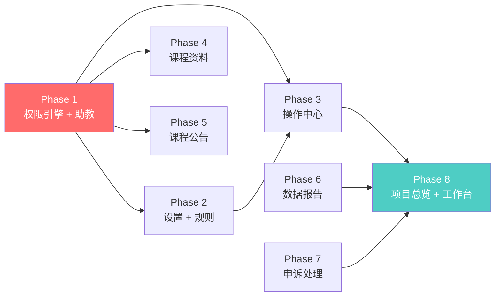

# 教师端产品级开发执行手册（带自动校验循环）

> **历史归档文档**：本文记录对应阶段的规划/验收快照，不代表当前最新状态；当前架构、实时交付状态与限制请以 [README.md](../../../README.md) 与 [FRONTEND_STATUS.md](../../../FRONTEND_STATUS.md) 为准。

- 编写日期：2026-11-17
- 编写人：规划方（只负责规划，不写代码）
- 执行方：其他模型或开发者
- 配套文档：`teacher-platform-design.md`（设计方案，定义"做什么"）
- 本文档定义：**"怎么做"、"怎么验"、"不过怎么办"**
- 状态：**待确认**

---

## 0. 通用执行规则

### 0.1 仓库与环境

```
仓库根目录: /Users/motasy_delay/GroupProof-team/groupproof  (下文简称 <repo>)
后端虚拟环境: <repo>/services/api/.venv/bin/python | pytest | ruff
前端命令前缀: npm --prefix groupproof run <script>
数据库迁移序号: 续接 0031，新迁移从 0032 开始
```

### 0.2 硬性禁令

1. **禁止** `git commit`、`git push`、`git reset`、`git checkout -- <file>`
2. **不修改**现有 B/C/D 模块 service 层的**已有方法行为**（可新增只读函数）
3. **不新增** npm 或 pip 依赖
4. 写操作必须走 `run_command` 幂等框架 + `Idempotency-Key`
5. 新增中文文案必须同步加入 `en.ts` + `zh-Hant.ts`
6. Docker 由用户自己运行，不代为操作

### 0.3 核心验证命令清单

以下命令合称 **「全套校验」**，每个阶段结束前必须全部通过：

| # | 命令 | 预期结果 | 失败含义 |
|---|---|---|---|
| V1 | `<venv>/ruff check services/api/` | exit 0, 无输出 | Python 代码风格/导入问题 |
| V2 | `<venv>/ruff format --check services/api/` | exit 0 | Python 格式不符 |
| V3 | `<venv>/pytest services/api/tests/ -x -q` | 全部 passed (可有 skipped) | 后端逻辑错误 |
| V4 | `npm --prefix groupproof run typecheck` | exit 0 | TypeScript 类型错误 |
| V5 | `npm --prefix groupproof run lint` | exit 0 | ESLint 违规 |
| V6 | `npm --prefix groupproof run check:routes` | "已核对 N 个设计页与路由" | 路由注册不完整 |
| V7 | `npm --prefix groupproof run check:ux` | "N 项断言全部符合预期" | UX 回归 |
| V8 | `npm --prefix groupproof run check:e2e` | "N 项断言全部符合预期" | 功能回归 |
| V9 | `npm --prefix groupproof run check:i18n` | "N 个键…核对通过" | 翻译键不一致 |
| V10 | `npm --prefix groupproof run check:ui-catalog` | 新增文件 0 条缺失 | 中文文案未翻译 |
| V11 | `npm --prefix groupproof run build` | exit 0, 构建成功 | 编译/打包错误 |

### 0.4 自动校验循环（Verify-Diagnose-Fix Loop）

每个阶段完成后，执行者**必须**按以下流程运行：

```
┌─────────────────────────────────────────────────────────────────┐
│                     VERIFY-DIAGNOSE-FIX LOOP                    │
│                                                                 │
│  ┌──────────┐    全部通过     ┌──────────────┐                  │
│  │ 运行全套  │──────────────→│ ✅ 阶段完成    │                  │
│  │ 校验 V1-V11│              │  输出校验报告  │                  │
│  └──────────┘              └──────────────┘                  │
│       │                                                        │
│       │ 存在失败                                                │
│       ▼                                                        │
│  ┌──────────┐                                                  │
│  │ DIAGNOSE │  根据失败的检查项定位问题：                        │
│  │ 诊断阶段  │  - 读取错误输出的完整信息                         │
│  │          │  - 定位到具体文件和行号                            │
│  │          │  - 分析错误原因（见各阶段的诊断表）                 │
│  └──────────┘                                                  │
│       │                                                        │
│       ▼                                                        │
│  ┌──────────┐                                                  │
│  │   FIX    │  按诊断结果修改代码：                              │
│  │ 修复阶段  │  - 只改与当前错误直接相关的代码                    │
│  │          │  - 不引入无关变更                                  │
│  │          │  - 记录修改内容到校验报告                          │
│  └──────────┘                                                  │
│       │                                                        │
│       ▼                                                        │
│  ┌──────────┐                                                  │
│  │ RE-VERIFY│  重新运行失败的校验项 + 全套校验                   │
│  │ 重新校验  │  （防止修复引入新问题）                            │
│  └──────────┘                                                  │
│       │                                                        │
│       │ 仍有失败 → 回到 DIAGNOSE（最多循环 5 次）               │
│       │ 循环 5 次仍失败 → 停止，输出完整错误日志，              │
│       │                   请求人工介入                          │
│       │                                                        │
│       │ 全部通过 → ✅ 阶段完成                                  │
│       │                                                        │
└─────────────────────────────────────────────────────────────────┘
```

**循环硬限制：单个阶段最多 5 次修复循环。第 5 次仍失败则停止并输出：**
1. 全部校验命令的完整输出
2. 每次循环的修改记录
3. 对剩余错误的分析
4. 建议的人工介入点

### 0.5 阶段校验报告模板

每个阶段完成时，输出以下格式的报告：

```markdown
## Phase N 校验报告

### 实现清单
- [x] 文件 A: 新增/修改，N 行
- [x] 文件 B: 新增/修改，N 行
- ...

### 校验结果
| # | 检查项 | 结果 | 备注 |
|---|---|---|---|
| V1 | ruff check | ✅ pass | |
| V2 | ruff format | ✅ pass | |
| ... | ... | ... | ... |

### 修复循环记录
- 循环 1: V4 失败 → 原因: XX → 修复: 文件 Y 第 Z 行 → V4 通过
- 循环 2: 无 → 全部通过

### 效果验证
- [ ] 效果 1: 描述 → 实际结果
- [ ] 效果 2: 描述 → 实际结果

### 遗留问题
- 无 / 列出
```

---

## Phase 1: 权限引擎 + 助教管理

### 1.1 实现目标

| 编号 | 交付物 | 文件路径 | 说明 |
|---|---|---|---|
| P1-01 | 数据库迁移 | `services/api/migrations/versions/0032_b_staff_permissions.py` | `course_staff` 新增 `permissions JSONB DEFAULT '{}'` 列 |
| P1-02 | 权限守卫函数 | `services/api/app/modules/b/teacher_permissions.py`（新增） | `require_staff_permission(session, user, course_id, permission_key)` 函数 |
| P1-03 | 助教管理 schemas | `services/api/app/modules/b/teacher_staff_schemas.py`（新增） | 请求/响应 DTO |
| P1-04 | 助教管理 service | `services/api/app/modules/b/teacher_staff_service.py`（新增） | 邀请/移除/编辑权限 3 个方法 |
| P1-05 | 助教管理 router | `services/api/app/modules/b/teacher_staff_router.py`（新增） | 5 个端点 |
| P1-06 | 路由挂载 | `services/api/app/modules/b/router.py`（修改） | 挂载 teacher_staff_router |
| P1-07 | 前端 API client | `groupproof/lib/api/teacher-staff-client.ts`（新增） | 助教 API 调用 |
| P1-08 | 前端页面 | `groupproof/features/teacher/TeacherStaffApiPage.tsx`（新增） | Screen 51 助教管理页 |
| P1-09 | 路由注册 | `groupproof/lib/routes.ts`（修改） | 添加 screen 51 路由 |
| P1-10 | 路由分发 | `groupproof/features/route-dispatcher.tsx`（修改） | 添加 screen 51 分发 |
| P1-11 | 导航菜单 | `groupproof/lib/ux/navigation.ts`（修改） | teacherNavItems 添加"助教管理" |
| P1-12 | 权限 hook | `groupproof/lib/hooks/use-teacher-permissions.ts`（新增） | `useTeacherPermissions(courseId)` |
| P1-13 | i18n 词条 | `en.ts` + `zh-Hant.ts`（修改） | 新增文案翻译 |
| P1-14 | 后端测试 | `services/api/tests/test_b_teacher_staff.py`（新增） | 权限守卫 + 助教 CRUD 测试 |

### 1.2 预期效果（用户可感知）

| 效果编号 | 描述 | 验证方法 |
|---|---|---|
| E1-01 | 教师进入 `/teacher/courses/{cid}/staff` 可以看到助教管理页面，页面标题为"助教管理"，右上角有"邀请助教"按钮 | 浏览器访问该 URL，确认页面渲染无白屏 |
| E1-02 | 教师输入一个已注册的 TA 用户邮箱，点击"发送邀请"后，该用户出现在助教列表中，默认权限全部关闭 | 调用 POST 接口后 GET list 确认 |
| E1-03 | 教师点击"编辑权限"，可以勾选/取消 6 项细粒度权限（审批加入/管理分组/管理资料/审批变动/导出报告/发布公告），保存后生效 | PATCH 接口后重新 GET 确认 permissions JSON |
| E1-04 | 助教登录后，访问班级内页面时，被禁用权限对应的操作按钮不显示或灰色禁用 | 助教角色 mock 访问，确认 UI 条件渲染 |
| E1-05 | 助教尝试调用超出权限的写接口，后端返回 `403 PERMISSION_DENIED` | 直接 curl/fetch 调用受限端点 |
| E1-06 | 教师点击"移除"某助教后，该助教不再出现在列表中，且不再能访问班级内教师页面 | POST remove 后 GET list 确认 |
| E1-07 | 班级内侧边栏导航新增"助教管理"入口（仅课程 owner 可见） | 确认 teacherNavItems 包含新条目 |

### 1.3 后端接口详细规格

#### 端点 1: 列出助教

```
GET /api/v1/teacher/classes/{course_id}/staff
权限: require_course_teacher(session, user, course_id)
返回: { data: StaffListDTO }
```

```python
class StaffMemberDTO(BaseModel):
    user_id: UUID
    name: str
    email: str
    role: Literal["teacher", "ta"]
    permissions: StaffPermissionsDTO  # 6 个 bool 字段
    joined_at: datetime
    is_owner: bool  # 是否是课程创建者

class StaffListDTO(BaseModel):
    items: list[StaffMemberDTO]
    total: int
```

#### 端点 2: 邀请助教

```
POST /api/v1/teacher/classes/{course_id}/staff/invite
权限: require_course_teacher(session, user, course_id) + 仅 owner
请求体: InviteStaff { email: str, role: "ta" | "teacher" }
返回: { data: StaffMemberDTO } (201)
错误: 404 USER_NOT_FOUND | 409 ALREADY_STAFF | 422 NOT_TEACHER_OR_TA
```

业务规则:
1. 被邀请人必须已注册且 `global_role` 为 `teacher` 或 `ta`
2. 被邀请人不能已是本课程的 staff
3. 写入 `course_staff(course_id, user_id, role, permissions='{}')` + `course_members` (如果不存在)
4. 发送通知给被邀请人
5. 写入审计日志 `staff.invited`

#### 端点 3: 修改助教权限

```
PATCH /api/v1/teacher/classes/{course_id}/staff/{user_id}/permissions
权限: require_course_teacher(session, user, course_id) + 仅 owner
请求体: UpdatePermissions { approve_joins?: bool, manage_groups?: bool, ... }
返回: { data: StaffMemberDTO }
错误: 404 STAFF_NOT_FOUND | 422 CANNOT_MODIFY_OWNER
```

#### 端点 4: 移除助教

```
POST /api/v1/teacher/classes/{course_id}/staff/{user_id}/remove
权限: require_course_teacher(session, user, course_id) + 仅 owner
请求体: RemoveStaff { reason: str }
返回: { data: { removed: true } }
错误: 404 STAFF_NOT_FOUND | 422 CANNOT_REMOVE_OWNER
```

业务规则:
1. 不能移除课程 owner
2. 设置 `course_staff.left_at = now()`
3. 同步设置 `course_members.left_at` (如果存在)
4. 发送通知 + 审计日志 `staff.removed`

#### 端点 5: 读取自身权限

```
GET /api/v1/teacher/classes/{course_id}/my-permissions
权限: require_course_staff(session, user, course_id)
返回: { data: MyPermissionsDTO }
```

```python
class MyPermissionsDTO(BaseModel):
    role: Literal["teacher", "ta"]
    is_owner: bool
    can_manage: bool  # 兼容现有 ClassDetailDTO
    permissions: StaffPermissionsDTO

class StaffPermissionsDTO(BaseModel):
    approve_joins: bool = True    # teacher 默认全 True
    manage_groups: bool = True
    manage_files: bool = True
    approve_changes: bool = True
    export_reports: bool = True
    post_announcements: bool = True
```

### 1.4 权限守卫函数规格

```python
# teacher_permissions.py

ALL_PERMISSIONS = {
    "approve_joins", "manage_groups", "manage_files",
    "approve_changes", "export_reports", "post_announcements",
}

def require_staff_permission(
    session: Session,
    user: User,
    course_id: UUID,
    permission: str,
) -> CourseStaff:
    """
    检查用户是否有指定的课程级细粒度权限。
    
    规则:
    1. 用户必须是该课程的 active staff (left_at IS NULL)
    2. role='teacher' → 始终通过 (忽略 permissions JSON)
    3. role='ta' → 检查 permissions JSON 中对应字段
    4. 不满足 → raise ApiError(403, "PERMISSION_DENIED", f"缺少权限: {permission}")
    """
```

### 1.5 修改现有教师接口接入权限

以下现有端点需要在入口处增加 `require_staff_permission` 调用：

| 现有端点 | 增加的权限检查 | 影响 |
|---|---|---|
| `POST .../assignments` (拖拽分组) | `require_staff_permission(..., "manage_groups")` | TA 未授权时返回 403 |
| `POST .../groups` (创建空队伍) | `require_staff_permission(..., "manage_groups")` | 同上 |
| `POST .../groups/{gid}/leader` (设置队长) | `require_staff_permission(..., "manage_groups")` | 同上 |
| `POST .../students/{uid}/remove` (移出学生) | 保持 `require_course_teacher` (不委托给 TA) | 不变 |
| `POST .../invite-code/rotate` (重置邀请码) | 保持 `require_course_teacher` (不委托给 TA) | 不变 |

**实现方式：** 在 `teacher_classes_service.py` 中对应方法的入口处，在 `require_course_teacher` 之后增加 `require_staff_permission` 调用。对于不委托给 TA 的操作，保持现有的 `require_course_teacher`（已经阻止了 TA）。

### 1.6 前端权限 hook 规格

```typescript
// lib/hooks/use-teacher-permissions.ts

export interface TeacherPermissions {
  role: "teacher" | "ta" | null;
  isOwner: boolean;
  canManage: boolean;
  approveJoins: boolean;
  manageGroups: boolean;
  manageFiles: boolean;
  approveChanges: boolean;
  exportReports: boolean;
  postAnnouncements: boolean;
  loading: boolean;
}

export function useTeacherPermissions(courseId: string): TeacherPermissions {
  // 调用 GET /teacher/classes/{cid}/my-permissions
  // 缓存策略: staleTime = 5min (权限变更不需要实时感知)
  // role === "teacher" 时所有权限返回 true (后端保证)
}
```

**前端接入点（需修改的现有组件）：**

| 组件 | 修改 | 条件渲染内容 |
|---|---|---|
| `TeamPlazaApiPage.tsx` | 导入 `useTeacherPermissions` | 拖拽功能、"新建队伍"按钮受 `manageGroups` 控制 |
| `TeacherGroupDetailApiPage.tsx` | 导入 `useTeacherPermissions` | "设为队长"按钮受 `manageGroups` 控制 |
| `ClassRosterSidebar.tsx` | 导入 `useTeacherPermissions` | "移出班级"按钮保持仅 teacher 可见（不委托 TA） |
| `TeacherClassLayout.tsx` | 导入 `useTeacherPermissions` | 导航项"助教管理"仅 `isOwner` 时显示 |

### 1.7 验证协议

#### 步骤 1: 后端校验

```bash
# V1: Python lint
cd <repo> && services/api/.venv/bin/ruff check services/api/

# V2: Python format
services/api/.venv/bin/ruff format --check services/api/

# V3: 后端测试（先只跑新增测试，再跑全量）
services/api/.venv/bin/pytest services/api/tests/test_b_teacher_staff.py -x -v
services/api/.venv/bin/pytest services/api/tests/ -x -q
```

**预期结果：**
- V1: exit 0, 无输出
- V2: exit 0
- V3: 新增测试 ≥ 8 cases passed；全量测试 ≥ 1019 passed, 0 failed

#### 步骤 2: 数据库迁移校验

```bash
# 检查迁移文件语法
services/api/.venv/bin/python -c "
import importlib.util
spec = importlib.util.spec_from_file_location('m', 'services/api/migrations/versions/0032_b_staff_permissions.py')
mod = importlib.util.module_from_spec(spec)
spec.loader.exec_module(mod)
print('upgrade exists:', hasattr(mod, 'upgrade'))
print('downgrade exists:', hasattr(mod, 'downgrade'))
print('revision:', mod.revision)
print('down_revision:', mod.down_revision)
"
```

**预期结果：**
```
upgrade exists: True
downgrade exists: True
revision: 0032...
down_revision: 0031...
```

#### 步骤 3: 前端校验

```bash
# V4-V11 全套前端校验
npm --prefix groupproof run typecheck
npm --prefix groupproof run lint
npm --prefix groupproof run check:routes
npm --prefix groupproof run check:ux
npm --prefix groupproof run check:e2e
npm --prefix groupproof run check:i18n
npm --prefix groupproof run check:ui-catalog  # 确认新增文件 0 条缺失
npm --prefix groupproof run build
```

#### 步骤 4: 效果验证

```bash
# 验证新端点注册成功（OpenAPI 生成后检查）
grep -c "teacher.*staff" services/api/scripts/export_openapi.py || echo "需要检查路由挂载"

# 验证路由注册
grep "51" groupproof/lib/routes.ts | head -3

# 验证导航条目
grep "助教管理" groupproof/lib/ux/navigation.ts
grep "助教管理" groupproof/lib/i18n/catalog/en.ts
grep "助教管理" groupproof/lib/i18n/catalog/zh-Hant.ts
```

### 1.8 诊断表（失败时对照）

| 失败的检查项 | 常见原因 | 修复方向 |
|---|---|---|
| V1 ruff check 报 import 错误 | 新增文件的导入路径错误 | 检查 `from app.modules.b.xxx import yyy` 路径 |
| V1 ruff check 报 unused import | 新增了但未使用的导入 | 删除未使用的 import |
| V3 pytest 报 `UNIQUE constraint` | 迁移未正确处理已有数据 | 迁移加 `server_default='{}'` |
| V3 pytest 报 `ModuleNotFoundError` | 新文件未在正确位置 | 检查文件路径和 `__init__.py` |
| V3 pytest 现有测试失败 | 修改现有 service 方法签名 | 保持原方法签名不变，新增函数 |
| V4 typecheck 报类型错误 | API client 返回类型不匹配 | 检查 TypeScript 接口定义 |
| V6 check:routes 报未核对 | screen 51 未添加到路由表 | 在 `routes.ts` 添加 screen 51 |
| V7 check:ux 断言失败 | 修改了现有组件的 DOM 结构 | 只添加新条件分支，不改原结构 |
| V10 check:ui-catalog 报缺失 | 新增中文文案未翻译 | 在 `en.ts` 和 `zh-Hant.ts` 中添加 |

---

## Phase 2: 班级设置 + 课程规则

### 2.1 实现目标

| 编号 | 交付物 | 文件路径 | 说明 |
|---|---|---|---|
| P2-01 | 规则版本迁移 | `services/api/migrations/versions/0033_b_course_rules.py` | 新增 `b_course_rule_versions` 表 + `courses.description` 列 |
| P2-02 | 规则 schemas | `services/api/app/modules/b/teacher_rules_schemas.py`（新增） | 规则版本 DTO |
| P2-03 | 规则 service | `services/api/app/modules/b/teacher_rules_service.py`（新增） | 规则 CRUD + 发布 |
| P2-04 | 规则 router | `services/api/app/modules/b/teacher_rules_router.py`（新增） | 5 个端点 |
| P2-05 | 设置 schemas | 追加到 `teacher_classes_schemas.py` | `UpdateSettings`、`ClassSettingsDTO` |
| P2-06 | 设置 service | 追加到 `teacher_classes_service.py` | 读写设置 + 课程状态管理 |
| P2-07 | 设置 router | 追加到 `teacher_classes_router.py` | 5 个新端点 |
| P2-08 | 前端设置页 | `groupproof/features/teacher/TeacherSettingsApiPage.tsx`（新增） | Screen 46 |
| P2-09 | 前端规则页 | `groupproof/features/teacher/TeacherRulesApiPage.tsx`（新增） | Screen 47 |
| P2-10 | 里程碑模板编辑器 | `groupproof/features/teacher/MilestoneTemplateEditor.tsx`（新增） | 可复用组件 |
| P2-11 | 路由分发 | `groupproof/features/route-dispatcher.tsx`（修改） | 添加 screen 46, 47 分发 |
| P2-12 | 前端 API client | `groupproof/lib/api/teacher-rules-client.ts`（新增） | 规则 API 调用 |
| P2-13 | i18n 词条 | `en.ts` + `zh-Hant.ts`（修改） | 新增文案翻译 |
| P2-14 | 后端测试 | `services/api/tests/test_b_teacher_rules.py`（新增） | 规则 CRUD + 版本化测试 |

### 2.2 预期效果

| 效果编号 | 描述 | 验证方法 |
|---|---|---|
| E2-01 | 教师进入 `/teacher/courses/{cid}/settings`，可以看到班级名称、学期、学院等字段的编辑表单，修改后点"保存"成功提示 | POST → GET 确认数据一致 |
| E2-02 | 教师可以切换"加入方式"（直接加入 / 审批加入），切换后立即生效 | 修改后学生端通过邀请码加入时行为对应变化 |
| E2-03 | 教师点击"结束课程"按钮后，弹出二次确认（需输入班级名称），确认后课程状态变为 `ended`，页面顶部出现"课程已结束"横幅 | POST end → GET detail 确认 status = "ended" |
| E2-04 | 课程结束后，所有写操作端点返回 `409 COURSE_NOT_ACTIVE` | curl 调用写端点确认 409 |
| E2-05 | 教师进入 `/teacher/courses/{cid}/rules`，可以看到组队规则、项目规则两个卡片，每个卡片有"编辑"按钮 | 浏览器确认页面渲染 |
| E2-06 | 教师编辑规则后，点击"发布规则"，规则版本号自增，版本历史区域显示变更记录 | POST publish → GET versions 确认版本号递增 |
| E2-07 | 教师可以管理里程碑模板：添加/删除/调整里程碑条目，每条包含标题和截止日期 | 组件交互 + POST 保存确认 |
| E2-08 | 课程规则发布后，已有项目**不受影响**（保持创建时的规则快照） | 确认无联动修改已有项目 |

### 2.3 后端接口详细规格

#### 设置端点

| Method | Path | 权限 | 说明 |
|---|---|---|---|
| GET | `/teacher/classes/{cid}/settings` | staff | 读取当前设置（含加入方式、截止日期、班级说明） |
| PATCH | `/teacher/classes/{cid}/settings` | teacher only | 更新设置（部分更新，乐观锁） |
| POST | `/teacher/classes/{cid}/end` | teacher only | 结束课程 |
| POST | `/teacher/classes/{cid}/reopen` | teacher only | 重新开启课程 |
| DELETE | `/teacher/classes/{cid}` | owner only | 删除课程（需无学生） |

```python
class UpdateSettings(BaseModel):
    name: str | None = None
    semester: str | None = None
    college: str | None = None
    description: str | None = None
    formation_deadline: AwareDatetime | None = None
    project_deadline: AwareDatetime | None = None
    min_group_size: int | None = None
    max_group_size: int | None = None
    join_mode: Literal["direct", "approval"] | None = None
    expected_version: int

    @model_validator(mode="after")
    def _check_sizes(self):
        if self.min_group_size and self.max_group_size:
            if self.min_group_size > self.max_group_size:
                raise ValueError("min > max")
        return self
```

业务规则:
- `end`: 设置 `course.status = "ended"`, 写入 `CourseLifecycleDecision(action="end")`
- `reopen`: 仅 `status == "ended"` → `"active"`, 写入 `CourseLifecycleDecision(action="reopen")`
- `delete`: 仅 `status == "ended"` 且 `course_members` 中无 active 学生
- 所有写操作: 通知所有 staff + 审计日志

#### 规则端点

| Method | Path | 权限 | 说明 |
|---|---|---|---|
| GET | `/teacher/classes/{cid}/rules` | staff | 当前生效规则 + 版本列表 |
| GET | `/teacher/classes/{cid}/rules/{version_no}` | staff | 历史版本详情 |
| PUT | `/teacher/classes/{cid}/rules/draft` | teacher | 保存规则草稿 |
| POST | `/teacher/classes/{cid}/rules/publish` | teacher | 发布新版本 |
| GET | `/teacher/classes/{cid}/rules/milestone-template` | staff | 当前里程碑模板 |

```python
class CourseRulesDTO(BaseModel):
    # 组队规则
    grouping_mode: Literal["free", "approval"]
    min_group_size: int
    max_group_size: int
    formation_deadline: datetime | None
    # 项目规则
    project_deadline: datetime | None
    milestone_template: list[MilestoneTemplateItem]
    require_baseline_review: bool = False
    require_plan_review: bool = False
    # 评分规则
    contribution_weights: ContributionWeights | None
    appeal_window_days: int = 7

class MilestoneTemplateItem(BaseModel):
    title: str
    description: str = ""
    deadline_offset_days: int | None  # 相对立项日期的偏移天数
    absolute_deadline: datetime | None  # 或绝对日期

class RuleVersionDTO(BaseModel):
    version_no: int
    status: Literal["draft", "published", "archived"]
    rules: CourseRulesDTO
    change_summary: str
    published_by: str | None
    published_at: datetime | None
    created_at: datetime
```

### 2.4 数据库迁移规格

```python
# 0033_b_course_rules.py
revision = "0033"
down_revision = "0032"

def upgrade():
    # 1. courses 表新增 description 列
    op.add_column("courses", sa.Column("description", sa.Text, nullable=True))

    # 2. 新增规则版本表
    op.create_table(
        "b_course_rule_versions",
        sa.Column("id", sa.UUID, primary_key=True, server_default=sa.text("gen_random_uuid()")),
        sa.Column("course_id", sa.UUID, sa.ForeignKey("courses.id"), nullable=False),
        sa.Column("version_no", sa.Integer, nullable=False),
        sa.Column("status", sa.String(20), nullable=False, server_default="draft"),
        sa.Column("rules_json", sa.JSON, nullable=False, server_default="{}"),
        sa.Column("change_summary", sa.Text, nullable=True),
        sa.Column("published_by", sa.UUID, sa.ForeignKey("users.id"), nullable=True),
        sa.Column("published_at", sa.DateTime(timezone=True), nullable=True),
        sa.Column("created_at", sa.DateTime(timezone=True), nullable=False, server_default=sa.text("now()")),
        sa.CheckConstraint("status IN ('draft', 'published', 'archived')", name="ck_rule_version_status"),
        sa.UniqueConstraint("course_id", "version_no", name="uq_rule_version_course_no"),
    )

def downgrade():
    op.drop_table("b_course_rule_versions")
    op.drop_column("courses", "description")
```

### 2.5 验证协议

同 Phase 1 的 V1-V11 全套校验，额外：

```bash
# 验证迁移链完整性
services/api/.venv/bin/python -c "
from alembic.config import Config
from alembic.script import ScriptDirectory
cfg = Config('services/api/alembic.ini')
scripts = ScriptDirectory.from_config(cfg)
heads = scripts.get_heads()
print('heads:', heads)
chain = list(scripts.walk_revisions())
revisions = [r.revision for r in chain]
print(f'chain length: {len(revisions)}')
print('latest 3:', revisions[:3])
"
```

**预期：** heads 只有 1 个，chain 包含 0032 和 0033，0033 → 0032 → 0031

### 2.6 诊断表

| 失败的检查项 | 常见原因 | 修复方向 |
|---|---|---|
| V3 迁移报 `DuplicateTable` | 表名与现有冲突 | 确认表名以 `b_` 前缀 |
| V3 `IntegrityError` on course description | 未设 `nullable=True` | 迁移加 `nullable=True` |
| V4 `Type 'undefined' is not assignable` | 规则 DTO 可选字段未处理 | 加 `| undefined` 或默认值 |
| V7 check:ux 失败 | 新增组件影响了现有 layout DOM | 检查 `TeacherClassLayout` 未破坏原有 tab 结构 |
| build 报 dynamic import 错误 | route-dispatcher 中 import 路径错误 | 检查 `() => import(...)` 路径 |

---

## Phase 3: 操作中心

### 3.1 实现目标

| 编号 | 交付物 | 文件路径 | 说明 |
|---|---|---|---|
| P3-01 | 操作聚合 service | `services/api/app/modules/b/teacher_actions_service.py`（新增） | 聚合查询 action_items |
| P3-02 | 操作聚合 schemas | `services/api/app/modules/b/teacher_actions_schemas.py`（新增） | 筛选/分页 DTO |
| P3-03 | 操作聚合 router | `services/api/app/modules/b/teacher_actions_router.py`（新增） | 4 个端点 |
| P3-04 | 路由挂载 | `services/api/app/modules/b/router.py`（修改） | 挂载 |
| P3-05 | 前端 API client | `groupproof/lib/api/teacher-actions-client.ts`（新增） | |
| P3-06 | 前端页面 | `groupproof/features/teacher/TeacherActionsApiPage.tsx`（新增） | Screen 44 |
| P3-07 | 筛选面板组件 | `groupproof/features/teacher/ActionFilterPanel.tsx`（新增） | 类型/状态/优先级筛选 |
| P3-08 | 操作卡片组件 | `groupproof/features/teacher/ActionCard.tsx`（新增） | 单个操作项展示 |
| P3-09 | 路由分发 | `groupproof/features/route-dispatcher.tsx`（修改） | screen 44 |
| P3-10 | 导航徽标 | `groupproof/features/teacher/TeacherClassLayout.tsx`（修改） | 操作中心 tab 显示待办数 |
| P3-11 | i18n 词条 | `en.ts` + `zh-Hant.ts`（修改） | |
| P3-12 | 后端测试 | `services/api/tests/test_b_teacher_actions.py`（新增） | |

### 3.2 预期效果

| 效果编号 | 描述 | 验证方法 |
|---|---|---|
| E3-01 | 教师进入 `/teacher/courses/{cid}/actions`，看到操作列表，左侧有类型/状态筛选面板 | 浏览器确认页面渲染 |
| E3-02 | 加入审批操作项显示学生信息、来源、时间，可直接点"批准"/"拒绝"完成处理 | 操作后确认 action_item status 变为 handled |
| E3-03 | 成员变动操作项显示任务交接摘要，点击"处理"跳转到成员变动页面 | 确认 href 正确指向 screen 48 |
| E3-04 | 里程碑逾期通知显示逾期天数、当前进度、未完成任务数 | 确认数据来源于 milestone_briefs |
| E3-05 | 筛选面板切换后，列表实时更新；"全部标记已读"可一键处理所有通知类操作项 | 操作后确认 |
| E3-06 | 班级内导航的"操作中心"标签旁显示红色徽标数字（待处理数量） | 确认 TeacherClassLayout 渲染徽标 |
| E3-07 | 教师点击"催办"按钮后，对应组的全体成员收到 urgent 通知 | POST remind → 查 notifications 表 |

### 3.3 后端接口详细规格

```
GET /api/v1/teacher/classes/{cid}/actions
  query: type (逗号分隔), status (pending|handled|all), priority, page, page_size
  权限: require_course_staff
  返回: { data: TeacherActionPageDTO }

POST /api/v1/teacher/classes/{cid}/actions/{action_id}/handle
  body: { action_key: str, reason?: str }
  权限: require_course_staff + require_staff_permission(依操作类型)
  返回: { data: TeacherActionItemDTO }

POST /api/v1/teacher/classes/{cid}/actions/batch
  body: { ids: UUID[], action_key: str, reason?: str }
  权限: require_course_staff
  返回: { data: { handled: int, failed: int, errors: [...] } }

POST /api/v1/teacher/classes/{cid}/actions/{action_id}/remind
  body: { message?: str }
  权限: require_course_staff
  返回: { data: { notified_count: int } }
```

**关键实现注意：**
- 此模块**不新建表**，直接查询现有 `action_items` 表
- 筛选条件：`action_items.course_id = cid AND action_items.assignee_id IN (course_staff_ids)`
- `handle` 操作根据 `action_item.type` 分发到现有处理逻辑：
  - `join_request` → 调用 `courses_service.decide_join`
  - `member_leave` / `member_remove` → 调用现有 `membership_service` 方法
  - 通知类 → 仅标记 `status = "handled"`

### 3.4 诊断表

| 失败的检查项 | 常见原因 | 修复方向 |
|---|---|---|
| V3 `action_items` 查询失败 | 表名或字段名不匹配 | 检查 ERD 中 `action_items` 的实际列名 |
| V3 `decide_join` 调用失败 | 参数签名不匹配 | 读取 `courses_service.decide_join` 函数签名确认 |
| V4 类型不匹配 | 后端返回的 JSON 结构与 TS 类型不一致 | 确保 DTO 定义与 TS interface 一致 |
| V8 check:e2e 失败 | 操作中心改变了现有 action_items 处理逻辑 | 确认只是新增聚合视图，不改原有处理流 |

---

## Phase 4: 课程资料中心

### 4.1 实现目标

| 编号 | 交付物 | 文件路径 | 说明 |
|---|---|---|---|
| P4-01 | 资料文件夹迁移 | `services/api/migrations/versions/0034_b_course_file_folders.py` | 新增 `b_course_file_folders` 表，`course_files` 增加 `folder_id` 和 `visibility` |
| P4-02 | 资料管理 service | `services/api/app/modules/b/teacher_files_service.py`（新增） | 文件夹 CRUD + 可见范围 |
| P4-03 | 资料管理 router | `services/api/app/modules/b/teacher_files_router.py`（新增） | 6 个端点 |
| P4-04 | 前端页面 | `groupproof/features/teacher/TeacherFilesApiPage.tsx`（新增） | Screen 50 教师增强版 |
| P4-05 | 路由分发 | `groupproof/features/route-dispatcher.tsx`（修改） | screen 50 |
| P4-06 | i18n + 测试 | 修改 `en.ts`, `zh-Hant.ts` + 新增测试文件 | |

### 4.2 预期效果

| 效果编号 | 描述 | 验证方法 |
|---|---|---|
| E4-01 | 教师看到文件夹树结构，可以创建/重命名/删除文件夹 | CRUD 后确认目录结构 |
| E4-02 | 教师上传文件到指定文件夹，文件显示在正确位置 | POST upload → GET list 确认 folder_id |
| E4-03 | 教师设置文件可见范围（全部/已分组/仅教职），学生端只看到被授权的文件 | 切换后学生端 GET 确认过滤 |
| E4-04 | 文件版本管理：教师可以上传新版本替换，版本历史保留 | 替换后 GET versions 确认历史 |

### 4.3 诊断表

| 失败 | 原因 | 修复 |
|---|---|---|
| V3 `course_files` 列不存在 | 迁移未包含 add_column | 迁移加 `op.add_column` |
| 学生端文件列表异常 | 修改了现有 `files_service` | 不改原有 service，教师端用独立 service |

---

## Phase 5: 课程公告

### 5.1 实现目标

| 编号 | 交付物 | 文件路径 |
|---|---|---|
| P5-01 | 公告表迁移 | `services/api/migrations/versions/0035_b_announcements.py` |
| P5-02 | 公告 service | `services/api/app/modules/b/teacher_announcements_service.py` |
| P5-03 | 公告 router | `services/api/app/modules/b/teacher_announcements_router.py` |
| P5-04 | 前端教师公告页 | `groupproof/features/teacher/TeacherAnnouncementsApiPage.tsx` (Screen 52) |
| P5-05 | 前端学生公告条 | `groupproof/features/b/AnnouncementBanner.tsx` |
| P5-06 | 路由 + 导航 + i18n + 测试 | 多文件修改 |

### 5.2 预期效果

| 效果编号 | 描述 | 验证方法 |
|---|---|---|
| E5-01 | 教师发布公告后，公告出现在列表顶部，标注发布时间和作者 | POST → GET list 确认 |
| E5-02 | 学生端 `/home` 和 `/courses` 顶部出现未读公告横条，点击展开内容，展开后标记已读 | 学生视角确认 banner 渲染 + POST read |
| E5-03 | 教师可以看到已读/未读名单，对未读学生点"催读"发送通知 | GET reads → POST remind |
| E5-04 | 教师可以置顶公告，置顶的公告始终排在最前 | PATCH pin → GET list 确认排序 |
| E5-05 | 教师发布紧急公告时，学生收到 urgent 级别的站内通知 | 查 notifications 表确认 |

---

## Phase 6: 数据报告中心

### 6.1 实现目标

| 编号 | 交付物 | 文件路径 |
|---|---|---|
| P6-01 | 报告聚合 service | `services/api/app/modules/b/teacher_reports_service.py` |
| P6-02 | 报告 router | `services/api/app/modules/b/teacher_reports_router.py` |
| P6-03 | 前端报告页 | `groupproof/features/teacher/TeacherReportsApiPage.tsx` (Screen 45) |
| P6-04 | 进度条形图组件 | `groupproof/features/teacher/charts/ProgressChart.tsx` |
| P6-05 | 里程碑时间线组件 | `groupproof/features/teacher/charts/MilestoneTimeline.tsx` |
| P6-06 | 风险矩阵组件 | `groupproof/features/teacher/charts/RiskMatrix.tsx` |
| P6-07 | 活跃度排行组件 | `groupproof/features/teacher/charts/ActivityRanking.tsx` |

### 6.2 预期效果

| 效果编号 | 描述 | 验证方法 |
|---|---|---|
| E6-01 | 顶部概览区显示 4 个统计卡片：学生数、队伍数、已立项数、整体进度 | GET overview 确认数据 |
| E6-02 | 进度条形图按队伍排列，每个队伍显示进度百分比和颜色标识（绿/黄/红） | 组件渲染确认 |
| E6-03 | 里程碑时间线矩阵显示每个队伍在每个里程碑的完成状态 | GET milestones 确认数据结构 |
| E6-04 | 风险预警区域列出所有高/中风险队伍，附逾期数和进度偏差 | GET risks 确认 |
| E6-05 | 活跃度排行显示每个学生的提交次数，低活跃学生用警告图标标注 | GET activity 确认 |
| E6-06 | 点击"导出"可以下载 PDF/Excel 报告 | POST export → 下载链接可访问 |

### 6.3 关键实现注意

报告数据**不新建表**，全部从现有数据聚合：

| 数据维度 | 来源表 | 聚合方式 |
|---|---|---|
| 队伍进度 | `milestones` + `tasks` + `task_milestones` | 复用 `milestone_briefs()` |
| 风险等级 | `risks` (D 模块) | 复用 `_risks()` |
| 活跃度 | `github_activities` + `feishu_records` + `progress_events` | COUNT GROUP BY user_id |
| 贡献度 | `contribution_snapshots` + `contribution_items` | 读取最新快照 |
| 任务完成 | `tasks` | COUNT WHERE status = "completed" |

---

## Phase 7: 申诉处理

### 7.1 实现目标

| 编号 | 交付物 | 文件路径 |
|---|---|---|
| P7-01 | 申诉管理 service | `services/api/app/modules/b/teacher_appeals_service.py` |
| P7-02 | 申诉管理 router | `services/api/app/modules/b/teacher_appeals_router.py` |
| P7-03 | 前端申诉页 | `groupproof/features/teacher/TeacherAppealsApiPage.tsx` (Screen 49) |
| P7-04 | 申诉详情面板 | `groupproof/features/teacher/AppealDetailPanel.tsx` |

### 7.2 预期效果

| 效果编号 | 描述 | 验证方法 |
|---|---|---|
| E7-01 | 教师看到所有申诉列表，按状态（待审核/已处理）筛选 | GET list 确认 |
| E7-02 | 申诉详情页显示：申诉内容 + 当前贡献度快照 + 该生任务记录 + GitHub 提交数 | GET detail 确认关联数据 |
| E7-03 | 教师可以"驳回"/"接受并调整贡献度"/"要求补充材料" | POST handle 确认状态流转 |
| E7-04 | 教师调整贡献度后，新的贡献度快照自动生成 | 确认新 snapshot 创建 |
| E7-05 | 学生收到申诉处理结果通知 | 查 notifications 表确认 |

### 7.3 关键实现注意

- **复用现有表**：`appeals`、`appeal_decisions`、`contribution_snapshots`、`contribution_items`
- 教师调整贡献度时，创建新的 `contribution_snapshot(status="adjusted")`
- 不修改原有贡献度计算逻辑，只新增"教师手动调整"能力

---

## Phase 8: 项目总览 + 教师工作台

### 8.1 实现目标

| 编号 | 交付物 | 文件路径 |
|---|---|---|
| P8-01 | 项目总览 service | `services/api/app/modules/b/teacher_projects_service.py` |
| P8-02 | 项目总览 router | `services/api/app/modules/b/teacher_projects_router.py` |
| P8-03 | 工作台 service | `services/api/app/modules/b/teacher_dashboard_service.py` |
| P8-04 | 工作台 router | `services/api/app/modules/b/teacher_dashboard_router.py` |
| P8-05 | 前端项目总览页 | `groupproof/features/teacher/TeacherProjectsApiPage.tsx` (Screen 53) |
| P8-06 | 前端工作台页 | `groupproof/features/teacher/TeacherDashboardApiPage.tsx` (Screen 58) |
| P8-07 | 项目卡片组件 | `groupproof/features/teacher/ProjectOverviewCard.tsx` |
| P8-08 | 路由 + 导航更新 | 多文件修改 |

### 8.2 预期效果

| 效果编号 | 描述 | 验证方法 |
|---|---|---|
| E8-01 | 教师进入 `/teacher/courses/{cid}/projects`，看到所有队伍的项目卡片，含进度/风险/最近活动 | GET projects 确认 |
| E8-02 | 未立项的队伍显示为灰色"未立项"卡片，提供"进入组队广场"链接 | 确认 UI 条件渲染 |
| E8-03 | 教师点击"发送催办"后，对应组全体收到通知 | POST remind → 查通知 |
| E8-04 | 教师进入 `/teacher/dashboard`，看到跨班级汇总：总待办数、各班级概览、全局风险、近期活动流 | GET dashboard 确认 |
| E8-05 | 教师从工作台点击某班级卡片，进入该班级首页 | 确认链接 href |
| E8-06 | 教师登录后，如果角色是 teacher/ta，侧边栏顶部显示"教师工作台"导航项 | 确认 workspace-shell 渲染 |
| E8-07 | 教师工作台的"待处理事项"聚合所有班级的未处理 action_items | GET dashboard/actions 确认 |

### 8.3 教师工作台数据聚合规格

```python
class DashboardDTO(BaseModel):
    # 聚合统计
    total_pending_actions: int
    total_classes: int
    total_students: int
    total_groups: int
    total_projects: int
    # 各班级摘要
    classes: list[DashboardClassDTO]
    # 全局风险
    high_risk_groups: int
    medium_risk_groups: int
    # 近期活动（跨班级前 20 条）
    recent_activity: list[DashboardActivityDTO]

class DashboardClassDTO(BaseModel):
    course_id: UUID
    name: str
    semester: str
    status: str
    student_count: int
    group_count: int
    project_count: int
    overall_progress: int | None
    pending_actions: int
    risk_count: int
    href: str
```

### 8.4 侧边栏导航最终结构

修改 `workspace-shell.tsx` 和 `navigation.ts`：

```typescript
// navigation.ts 新增
export function teacherGlobalNavItems(): NavItem[] {
  return [
    { label: "教师工作台", href: "/teacher/dashboard", icon: LayoutDashboard },
    { label: "我的班级", href: "/teacher/courses", icon: BookOpen },
  ];
}

// teacherNavItems 更新为完整列表
export function teacherNavItems(courseId: string): NavItem[] {
  return [
    { label: "班级首页", href: `/teacher/courses/${courseId}`, icon: Home },
    { label: "组队广场", href: `/teacher/courses/${courseId}/groups`, icon: Users },
    { label: "操作中心", href: `/teacher/courses/${courseId}/actions`, icon: Inbox },
    { label: "项目总览", href: `/teacher/courses/${courseId}/projects`, icon: FolderKanban },
    { label: "班级报告", href: `/teacher/courses/${courseId}/reports`, icon: BarChart3 },
    { label: "课程规则", href: `/teacher/courses/${courseId}/rules`, icon: Scale },
    { label: "课程资料", href: `/teacher/courses/${courseId}/files`, icon: FileText },
    { label: "课程公告", href: `/teacher/courses/${courseId}/announcements`, icon: Megaphone },
    { label: "助教管理", href: `/teacher/courses/${courseId}/staff`, icon: UserCog },
    { label: "班级设置", href: `/teacher/courses/${courseId}/settings`, icon: Settings },
  ];
}
```

**c-shell-api.spec.ts 兼容性：** 该测试断言 `aside nav a` 的 `href` 包含 `course`。上述所有新增导航项的 href 都包含 `/teacher/courses/${courseId}/...`，自然满足 `contains(course)` 断言。

---

## 附录 A: 阶段间依赖关系



**关键依赖：**
- Phase 1 是**所有后续阶段的前置**（权限 hook 在每个页面都要用）
- Phase 2 → Phase 3（设置中的课程状态变更会产生操作项）
- Phase 3, 6, 7 → Phase 8（工作台聚合操作中心、报告、申诉数据）
- Phase 4, 5 可与 Phase 2-3 **并行开发**（无数据依赖）

**推荐执行顺序：** P1 → P2 → P3 → (P4 ∥ P5) → P6 → P7 → P8

---

## 附录 B: 最终校验清单

所有 8 个阶段完成后，执行一次**全局集成校验**：

```bash
# 1. 后端全量
services/api/.venv/bin/ruff check services/api/
services/api/.venv/bin/ruff format --check services/api/
services/api/.venv/bin/pytest services/api/tests/ -x -q --tb=short

# 2. 前端全量
npm --prefix groupproof run typecheck
npm --prefix groupproof run lint
npm --prefix groupproof run check:routes
npm --prefix groupproof run check:ux
npm --prefix groupproof run check:e2e
npm --prefix groupproof run check:i18n
npm --prefix groupproof run check:ui-catalog
npm --prefix groupproof run build

# 3. 迁移链完整性
# 确认 0032-0035 四个迁移文件存在且链条连续

# 4. 路由完整性
# 确认 screen 44-53, 57, 58 全部有真实 API 页面（不再有 BNotConnectedPage）
grep -c "BNotConnectedPage" groupproof/features/route-dispatcher.tsx
# 预期: 0 (教师页面全部实现) 或仅剩非教师页面

# 5. 导航完整性
# 确认 teacherNavItems 返回 10 个条目
grep -c "href:" groupproof/lib/ux/navigation.ts  # teacherNavItems 区域

# 6. i18n 完整性
# 确认 check:ui-catalog 对新增文件的缺失数为 0
npm --prefix groupproof run check:ui-catalog 2>&1 | grep -E "features/teacher/" | wc -l
# 预期: 0
```

**全部通过后，输出最终交付报告，包含：**
1. 新增文件清单（带行数）
2. 修改文件清单（带 diff 行数）
3. 新增数据库迁移清单
4. 新增 API 端点清单（约 30+ 个）
5. 新增前端页面清单（约 10 个）
6. 所有校验通过的输出截图/日志
7. 已知限制和后续优化建议
